# Rich Studio

Локальный сервис для постов в Telegram-канал с полным Rich Messages (Bot API 10.3, `sendRichMessage`): визуальный редактор, предпросмотр как в Telegram, публикация в несколько каналов, закреп, первый комментарий, опросы, кнопки с ответами, а также HTTP API, MCP-сервер для AI-агентов и skill для Claude Code.

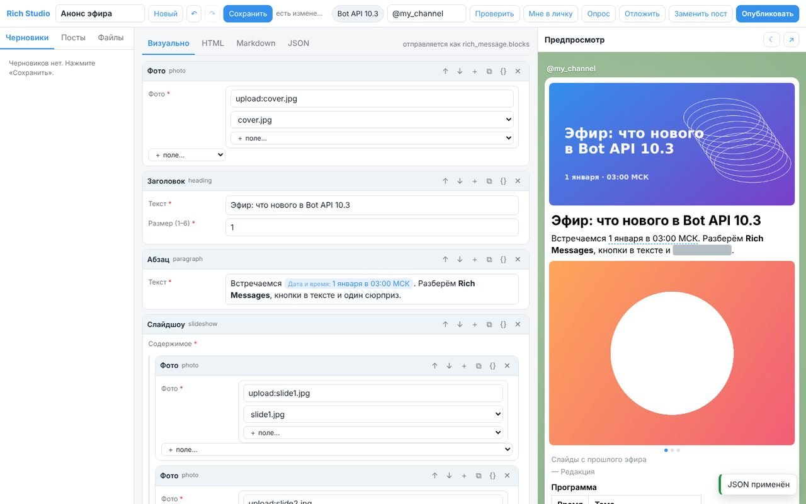

Все скриншоты ниже сняты с тестового запуска студии на подставном Telegram API (`tests/mock_telegram.py`), примеры запросов и ответов взяты оттуда же. 9 октября 2026 студия прошла прогон на настоящем Bot API в тестовой супергруппе: все примеры, медиа, кнопки, закреп, опросы, замена с историей, отложка, `Idempotency-Key`, `dry_run`, редактор и MCP. Возможности только для каналов (первый комментарий в обсуждении, `members_only` у опроса, закреп в канале) на настоящем канале ещё не проверялись, поэтому первую публикацию сделайте в тестовый канал.

**Содержание:** [что умеет](#что-умеет) · [быстрый старт](#быстрый-старт) · [редактор](#редактор) · [предпросмотр](#предпросмотр) · [публикация и работа с каналом](#публикация-и-работа-с-каналом) · [HTTP API](#http-api) · [MCP для агентов](#mcp-для-claude-и-других-агентов) · [skill](#skill-для-claude-code) · [безопасность](#безопасность) · [тесты](#тесты) · [структура](#структура)

## Что умеет

| Область | Возможности |
|---|---|
| Редактор | все 24 типа блоков Bot API 10.3, форматирование текста, режимы «Визуально», HTML, Markdown, JSON, черновики с автосохранением, отмена и возврат правок |
| Предпросмотр | вид как в Telegram в светлой и тёмной теме, таблицы, формулы, спойлеры, слайдшоу, карты, кнопки; отдельная страница для ссылки |
| Публикация | сразу, по расписанию, «мне в личку», в несколько каналов, замена текста или только кнопок, удаление |
| Канал | закреп без уведомления, первый комментарий в обсуждении, ответы на callback-кнопки, опросы и викторины для каналов, счётчики реакций и нажатий |
| Свежесть | редактор строится из машиночитаемой спецификации Bot API, новые поля работают в день релиза |
| Агенты | HTTP API, MCP-сервер на `/mcp` с 23 инструментами и предпросмотром прямо в чате, `dry_run`, `Idempotency-Key`, отметка о том, кто отправил пост |

## Быстрый старт

Нужен Docker (Docker Desktop на Mac/Windows).

```bash
cd rich-studio
cp .env.example .env        # впишите TG_BOT_TOKEN, TG_DEFAULT_CHAT, TG_PREVIEW_CHAT
docker compose up -d --build
```

Откройте http://localhost:8080. Документация API: http://localhost:8080/docs.

- **Бот:** токен от [@BotFather](https://t.me/BotFather). В канале сделайте бота админом с правом «Публикация сообщений», для правки ещё «Редактирование сообщений». Кнопка канала в шапке открывает окно «Каналы», где «Проверить» покажет, всё ли в порядке.
- **«Мне в личку»:** в `TG_PREVIEW_CHAT` ваш числовой id ([@userinfobot](https://t.me/userinfobot)); один раз напишите своему боту `/start`.
- Сервис слушает только `127.0.0.1`. Если откроете его в сеть, задайте `STUDIO_API_KEY`.
- Данные лежат в `./data` (черновики, посты, файлы, кэш спецификации). Обновление: `docker compose up -d --build`.

Без Docker: `pip install -r requirements.txt`, затем `cd app && DATA_DIR=../data uvicorn main:app --port 8080` (переменные из `.env` экспортируйте сами).

**Посмотреть студию без бота и токена:** `make mock` и `make dev` в двух терминалах. Студия откроется на http://localhost:8080 и будет «публиковать» в подставной Telegram; так сняты все скриншоты этого файла.

## Как «всегда свежий» устроен

1. **Разметка уходит в Telegram без изменений.** Студия не переводит пост в свои классы, поэтому любой новый тег, блок или поле работает в день релиза, даже если студия о нём не знает (вкладки HTML и JSON, кнопка `{}` у блока, метод `/api/raw/<метод>`).
2. **Редактор строится из спецификации.** Палитра блоков, формы полей, выпадающие списки значений, элементы текста и проверка берутся из машиночитаемой спецификации Bot API ([telegram-bot-api-spec](https://github.com/PaulSonOfLars/telegram-bot-api-spec), пересобирается с core.telegram.org при каждом релизе). Сервис проверяет её при запуске и каждые 12 часов, а кнопка ↻ рядом с версией вверху (или `POST /api/spec/refresh`, или инструмент MCP `refresh_bot_api`) проверяет сразу и показывает версию, изменения и чего не хватает подписям и предпросмотру. Новые блоки появляются в палитре сами, а бейдж версии вверху подсвечивается и показывает, что изменилось. Копию в репозитории (`app/bundled/api.json`) раз в неделю обновляет рутина Claude: `make spec-update`, подписи и отрисовка новых блоков, PR.
3. **Без интернета** работает встроенная копия спецификации 10.3.

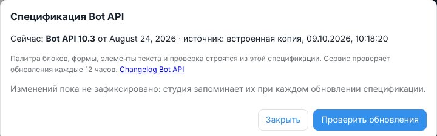

Что обновляется вручную: русские подписи блоков (без них показывается имя из спецификации), заготовки HTML-тегов в `app/static/snippets.js` и правила разбора HTML и Markdown в `render.js` (грамматики нет в спецификации; сверяются с настоящим Telegram через `scripts/capture_telegram_parse.py` и `npm run test:parity`) и отрисовка новых блоков в предпросмотре (до этого новый блок показывается рамкой с его JSON). Чего из этого не хватает для текущей спецификации, показывает окно спецификации (поле `gaps` в `GET /api/spec`) и проверяет тест `tests/test_spec_coverage.py`.

## Редактор

| Вкладка | Что это |
|---|---|
| **Визуально** | Конструктор из блоков (`rich_message.blocks`): заголовки, таблицы с объединением ячеек, списки и чек-листы, цитаты, раскрывашки, коллажи, слайдшоу, карты, кнопки, медиа. Текст с панелью форматирования (выделите текст), через «＋ элемент» вставляются дата-время, кастомные эмодзи, формулы, сноски, якоря, кнопки в тексте и всё остальное из спецификации. |
| **HTML** | Rich HTML с панелью заготовок; ⚠ у кнопки значит, что синтаксис взят из сторонних источников. |
| **Markdown** | Rich Markdown (GFM + разрешённые теги). |
| **JSON** | Весь запрос целиком: `rich_message`, `reply_markup`, `options`. |

Кнопка «＋ блок» открывает палитру. Все блоки в ней взяты из спецификации, при наведении видно описание:

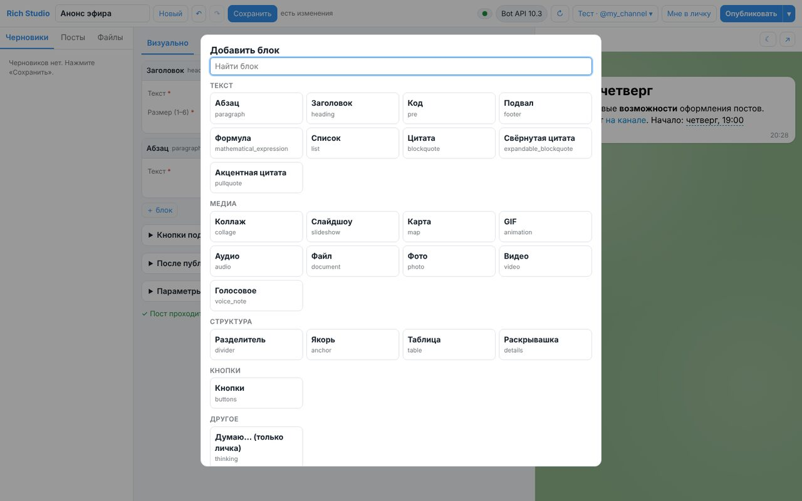

Элементы внутри текста (здесь дата и время с часовым поясом) редактируются в окне, поля которого тоже построены по спецификации. В предпросмотре дата сразу показывается так, как её увидит подписчик:

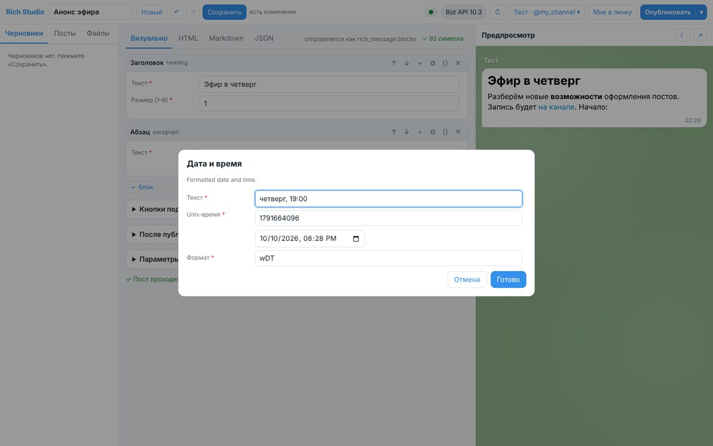

Пост из нескольких блоков: заголовок, абзац с жирным текстом и датой, таблица, фото из загрузок и кнопка. Внизу редактора всегда видна проверка по спецификации со счётчиком символов:

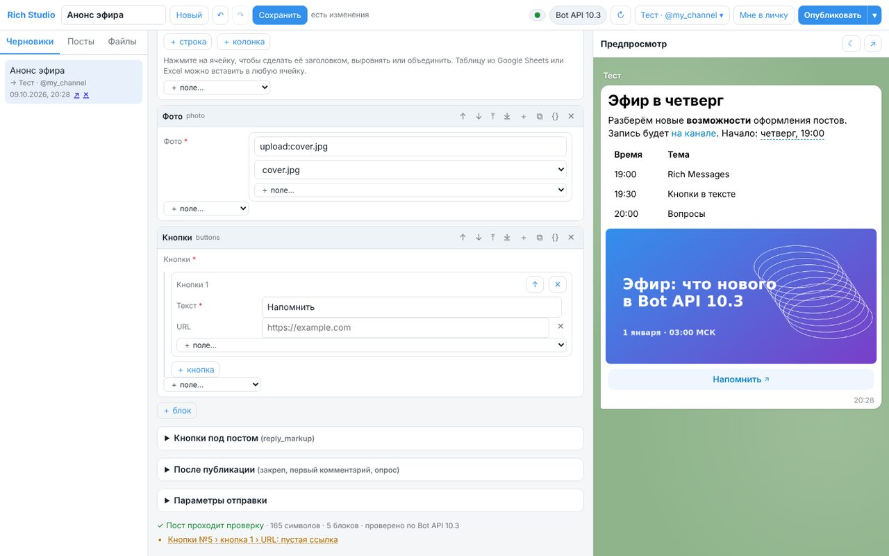

Режим HTML с панелью тегов. У каждого режима свой текст; отправляется тот, что открыт (кроме JSON):

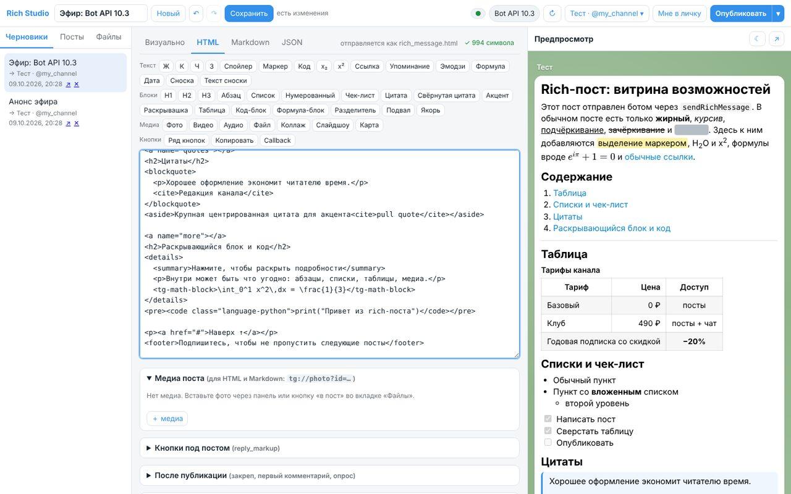

Кнопки ↶ ↷ (или Ctrl+Z и Ctrl+Shift+Z вне текстовых полей) отменяют и возвращают правки всего поста. Здесь три шага назад убрали фото и кнопку, а таблица вернулась к пустой:

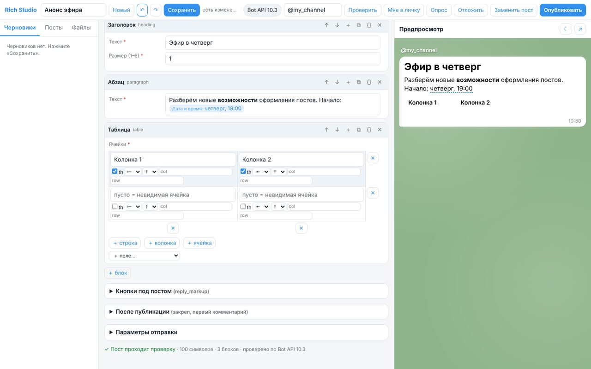

Ниже блоков: медиа поста для HTML/Markdown, кнопки под постом, панель «После публикации» (закреп и первый комментарий) и параметры отправки (без звука, защита от пересылки и любые другие параметры `sendRichMessage`).

Слева: черновики (автосохранение), посты (опубликованные и отложенные; открыть, заменить, удалить или отменить) и файлы (загрузка перетаскиванием, кнопка «в пост»).

## Предпросмотр

Предпросмотр справа повторяет вид Telegram в светлой и тёмной теме: таблицы, формулы (KaTeX), спойлеры, свёрнутые цитаты, слайдшоу, карта (OpenStreetMap), кнопки. Он изолирован от стилей редактора, ссылки-якоря прокручивают его внутри. Кнопка ↗ открывает пост отдельной страницей.

HTML и Markdown предпросмотр разбирает так же, как настоящий Telegram: спойлер `||текст||`, маркер `==текст==`, формулы `$…$` и `$$…$$`, сноски `[^1]`, таблицы. Правила записаны с настоящего бота: `tests/telegram_parse/captured.json` хранит 29 примеров вместе с блоками, которые вернул Telegram, а `npm run test:parity` проверяет, что предпросмотр рисует их одинаково. После обновления Bot API их стоит записать заново: `PARSE_CHAT=<чат> python scripts/capture_telegram_parse.py` (нужен токен; сообщения уходят без звука и сразу удаляются).

После «Мне в личку» над предпросмотром появляется сверка: Telegram возвращает блоки, на которые разобрал пост, и студия сравнивает с ними свой предпросмотр. «✓ так же» или «≠ иначе» с местом, где они расходятся; кнопка «Как разобрал Telegram» показывает пост из его блоков, а «В визуальный» переносит HTML или Markdown в визуальный режим ровно так, как его понял Telegram (исходный текст остаётся в своей вкладке, медиа ссылаются на уже загруженные в Telegram файлы). Если пост изменился после отправки, сверка просит отправить его ещё раз.

Примеры из папки `examples/`, отрисованные тестом `npm run test:shots`:

| `post-showcase.html`, светлая тема | `post-blocks.json`, тёмная тема |
|---|---|
| 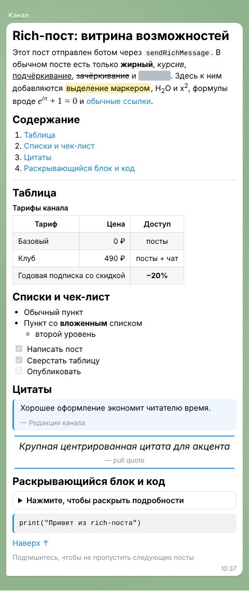 | 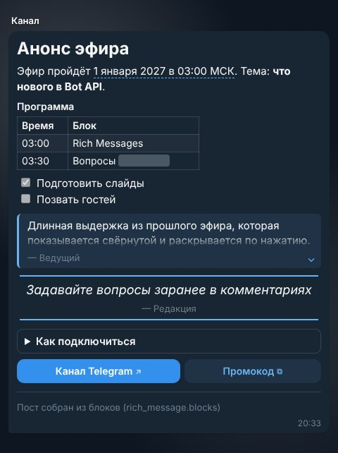 |
| **`post-media.html`, светлая тема** | **`post-extras.html`, тёмная тема** |
| 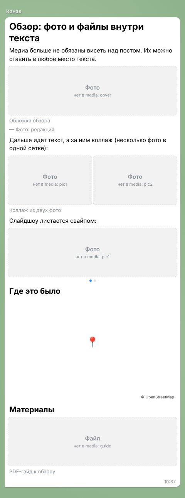 | 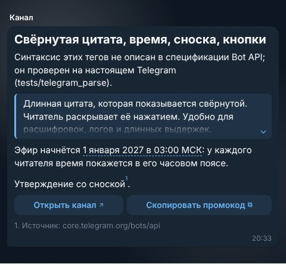 |

Тот же анонс со слайдшоу, картой и кнопками в тёмной теме редактора:

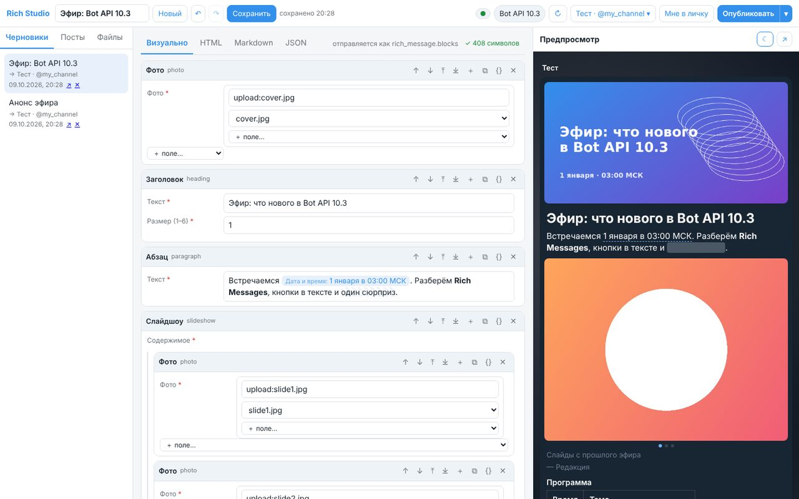

## Публикация и работа с каналом

**Каналы.** Канал принадлежит черновику: он сохраняется вместе с ним, и черновик для канала A, открытый завтра, уйдёт в A, а не туда, куда публиковали последним. Новый черновик начинается с канала по умолчанию (`TG_DEFAULT_CHAT`). В шапке кнопка с названием канала открывает окно «Каналы»: выбрать канал («Сюда»), добавить новый и проверить его. Студия спрашивает у Telegram название и права бота и дальше показывает название в шапке, в предпросмотре и в подтверждении публикации. Для форума рядом с кнопкой появляется выбор темы (`message_thread_id`). Bot API не умеет перечислять темы форума, поэтому новые темы студия запоминает сама, когда видит их создание, а существующие добавляются вручную по номеру из ссылки. Тема принадлежит каналу: при смене канала она снимается, а `message_thread_id` при нескольких каналах или для известного канала-не-форума студия не отправляет (400). Публикация по `draft_id` удалённого черновика без явного `chat_id` тоже даёт 400, а не уходит в канал по умолчанию.

**Проверка бота.** «Проверить» в окне «Каналы» спрашивает у Telegram, админ ли бот в канале и есть ли у него права:

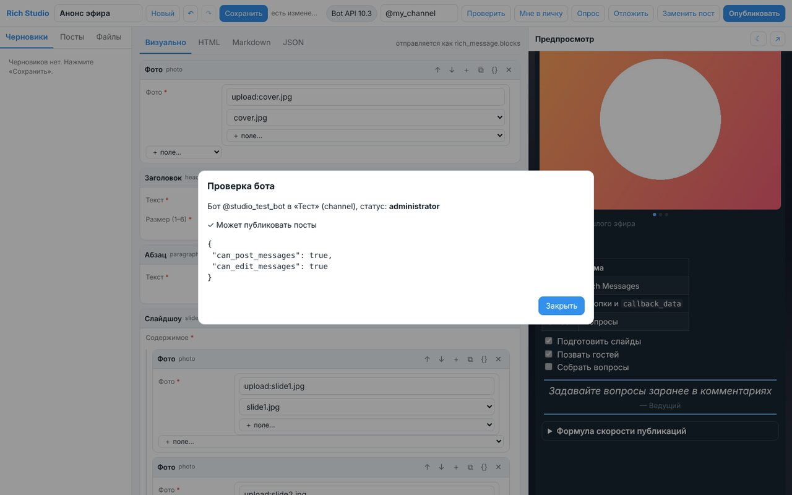

**Публикация.** «Опубликовать» отправляет пост сразу, «Отложить» по расписанию (с часовым поясом), «Мне в личку» отправляет его вам. Опубликованный пост появляется во вкладке «Посты» с `message_id`:

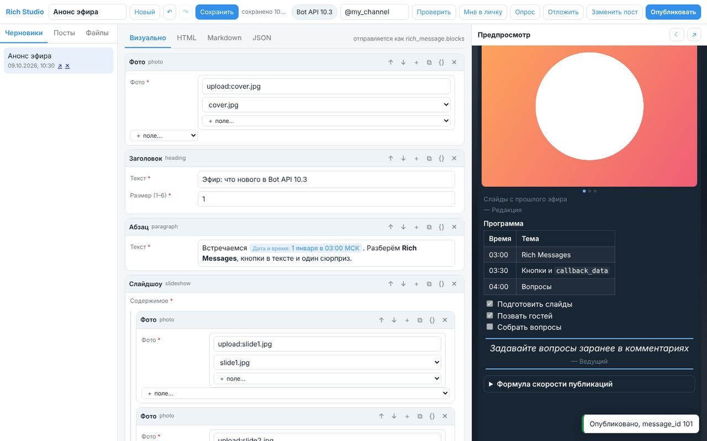

Отложенные посты отправляет сам сервис, поэтому в момент публикации контейнер должен работать. Если он был выключен и пост опоздал больше чем на час (`SCHEDULE_LATE_MIN`), студия его не отправляет, а помечает «пропущен»: утренний анонс, ушедший вечером, хуже, чем никакой. Откройте его и опубликуйте или отложите заново. Если Telegram недоступен (нет сети после сна ноутбука), пост ничего не потерял: студия повторит попытку через минуту, пока не выйдет тот же час. Если отложенный пост или черновик использует файл, удалить файл можно только со второго подтверждения.

**Черновик в двух вкладках.** Новый пост сохраняется черновиком сам, через пару секунд после первой правки. Если тот же черновик сохранили в другой вкладке или агентом, редактор не перезапишет его молча, а спросит: открыть их версию или сохранить свою поверх.

**Несколько каналов.** В окне «Каналы» впишите в поле «Куда публиковать» несколько через запятую (`@one, @two`). Пост уйдёт в каждый; если один канал не принял, остальные всё равно получат пост, а ошибка покажется отдельно. Отложка тоже создаётся для каждого канала.

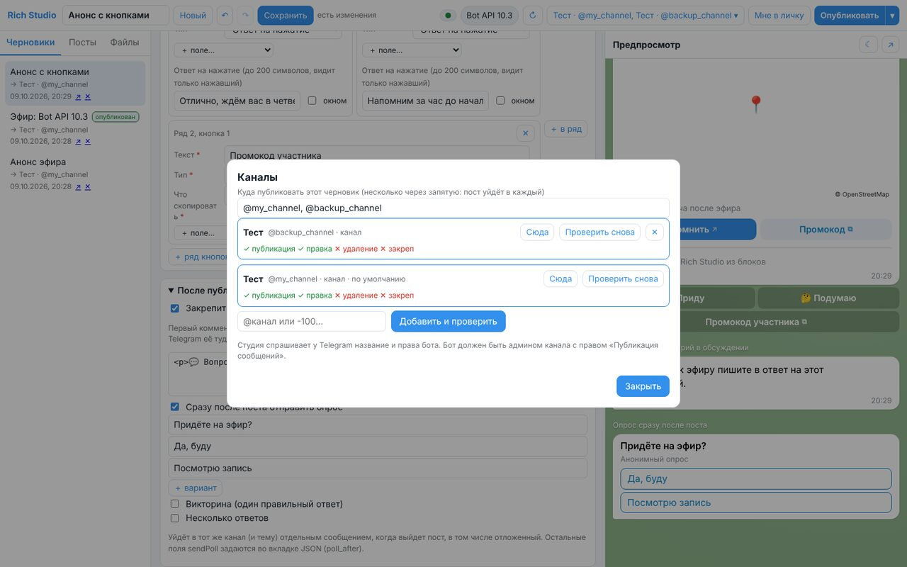

**Ответы на callback-кнопки.** У кнопки с `callback_data` есть поле «Ответ на нажатие» (всплывающая подсказка или окно). Студия отвечает на каждое нажатие, даже без заданного текста, иначе кнопка у читателя «крутится». Нажатия считаются в списке постов.

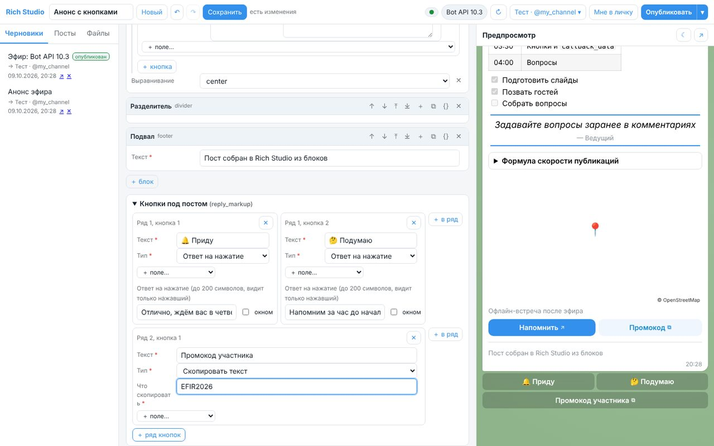

**Закреп и первый комментарий.** В панели «После публикации». Закреп ставится без уведомления подписчиков, боту нужно право «Редактирование сообщений» (или «Закрепление»). Когда Telegram перешлёт пост в группу обсуждения, студия ответит на него текстом комментария. При `TG_UPDATES=off` студия пересылку не увидит, поэтому сразу предупредит, что комментария не будет; если пересылка не пришла за сутки, комментарий помечается ошибкой. Бот должен быть **админом группы обсуждения**, иначе он не видит пересылку. Комментарий виден в предпросмотре под постом, а в «Мне в личку» приходит ответом на пост.

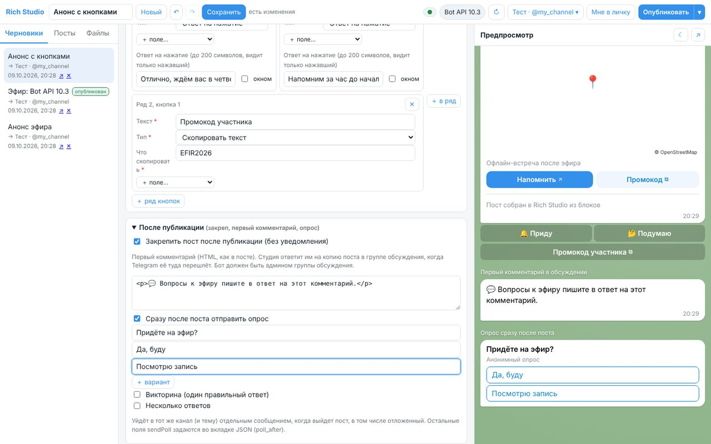

**Опросы.** Кнопка «Опрос» в шапке. Викторина с пояснением, несколько ответов, «только подписчики старше суток» (`members_only`), ограничение по странам, описание, автозакрытие, скрытые до закрытия результаты, закреп, отложка; остальные параметры `sendPoll` можно дописать JSON-ом.

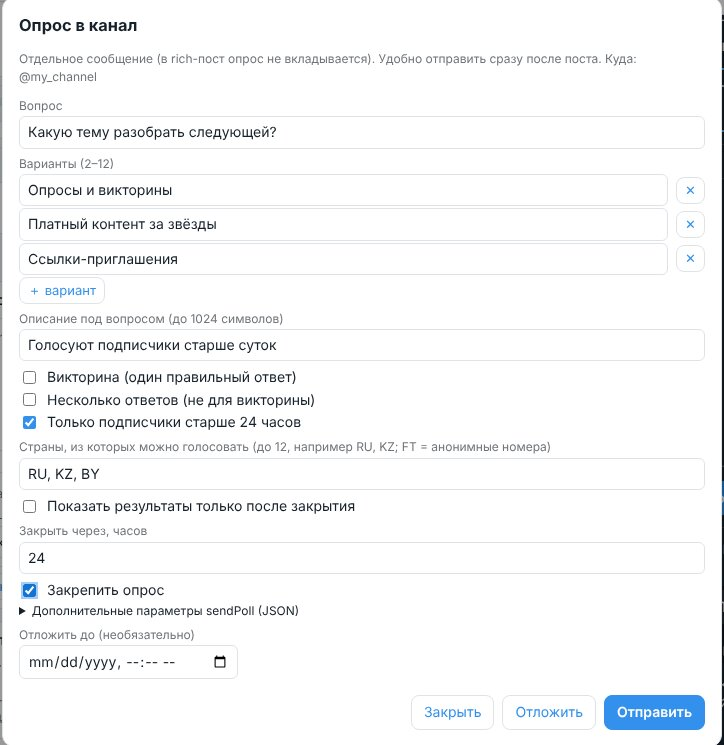

**Обратная связь.** Во вкладке «Посты» видно состояние приёма событий, закреп, реакции, нажатия кнопок, статус первого комментария и итоги опросов (там же «Закрыть опрос»). У поста есть кнопки «Править», «Кнопки» (заменить только кнопки через `editMessageReplyMarkup`, текст не меняется), «Закрепить / Открепить» и «Удалить».

**Правка опубликованного поста.** «Править» открывает пост черновиком-копией, а над редактором появляется плашка «Правите пост #N в @канал». Кнопка «Обновить пост» в ней заменяет именно этот пост (`editMessageText`), а «Опубликовать» в шапке предупредит, что выйдет новый пост. Черновик помнит, какой пост он правит, и после перезагрузки плашка вернётся. «История» показывает, как пост выглядел до каждой замены (из редактора, API или агентом), любую версию можно загрузить в редактор и вернуть в канал. Отложенный пост можно «Перенести», пропущенный «Отложить заново» или отменить.

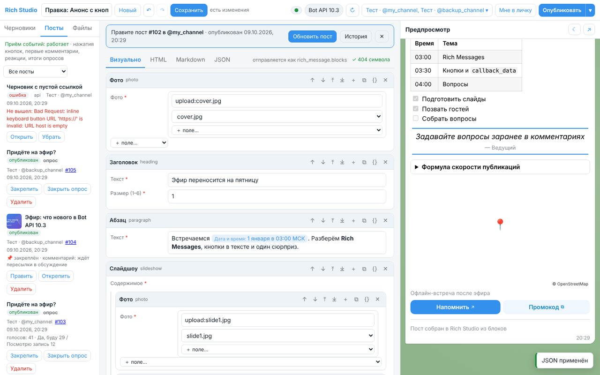

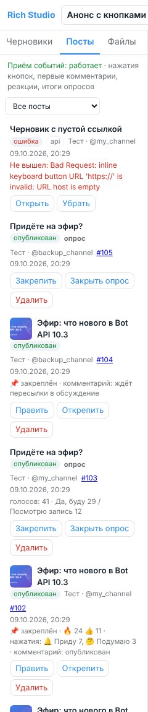

Нажатия, комментарии, реакции и итоги опросов студия получает сама через `getUpdates`. Если этот же бот уже работает где-то ещё (вебхук или другой процесс с `getUpdates`), будет конфликт: заведите для студии отдельного бота или выключите приём (`TG_UPDATES=off`), тогда остальное работает, а кнопки, комментарии и счётчики нет. Просмотров и охватов Bot API не отдаёт.

## HTTP API

Поле `post` везде одинаковое: `{"rich_message": {...}, "reply_markup": {...}, "options": {...}, "pin": true, "comment": {"html": "..."}, "callbacks": {"like": "Спасибо!"}}`. Последние три поля студия обрабатывает сама и в Telegram их не отправляет. Файлы из загрузок указываются как `upload:<имя>`.

| Метод | Что делает |
|---|---|
| `GET /api/spec`, `GET /api/spec/type/{name}`, `POST /api/spec/refresh` | версия и типы Bot API, обновление с отчётом об изменениях |
| `POST /api/validate` | проверка по спецификации: ошибки, предупреждения, символы |
| `POST /api/render?theme=dark` | отдельная HTML-страница предпросмотра |
| `GET/POST/PUT/DELETE /api/drafts` | черновики (открываются в редакторе); `chat_ids` — каналы черновика, публикация из него без `chat_id` уходит туда; `PUT` с `version` вернёт 409, если черновик сохранили в другом месте |
| `POST /api/preview-send` | отправить себе в личку; в ответе `parsed`: блоки, на которые Telegram разобрал пост, и они же для повторной отправки (`input_blocks`) |
| `GET /api/check?chat_id=` | бот админ канала? права? Канал запоминается с названием |
| `GET/POST /api/channels`, `PUT /api/channels/{id}/topics`, `DELETE /api/channels/{id}` | каналы: название, форум и его темы, права бота; темы вручную (Bot API их не перечисляет) или сами из событий создания темы |
| `POST /api/send`, `/api/schedule`, `/api/edit`, `/api/posts/{id}/edit`, `DELETE /api/posts/{id}` | публикация (`chat_ids` для нескольких каналов), отложка, замена, удаление |
| `POST/DELETE /api/posts/{id}/pin`, `POST /api/posts/{id}/buttons` | закрепить, открепить, заменить только кнопки |
| `GET /api/posts/{id}/versions`, `POST /api/posts/{id}/reschedule` | как пост выглядел до каждой замены; перенести отложенный или вернуть пропущенный |
| `POST /api/poll`, `POST /api/posts/{id}/stop-poll` | опрос или викторина (сразу или с `at`), закрыть опрос |
| `GET /api/updates` | состояние приёма событий от Telegram |
| `GET /api/health` | состояние студии: проверки `ok/warn/fail` с подсказкой, что делать, счётчики, последние ошибки |
| `GET /api/logs?level=&limit=&since=&logger=&q=` | журнал студии (строки JSON) с фильтрами; `q=<request_id>` — всё, что сделал один запрос |
| `GET /healthz`, `GET /readyz` | жив ли процесс; готова ли студия работать (503 и имена сбойных проверок), обе без ключа |
| `GET /api/export` | бэкап: zip с базой и файлами |
| `POST /api/media`, `GET /api/media`, `POST /api/media/cleanup`, `DELETE /api/media/{name}` | загрузка файлов; `used` у файла, удаление всех ненужных; удаление файла, нужного отложенному посту или черновику, даёт 409 (`?force=true` удаляет всё равно) |
| `POST /api/raw/{method}` | любой метод Bot API как есть |

Время в `/api/schedule` передавайте как unix или ISO 8601 с часовым поясом (`2026-10-10T09:00:00+03:00`). Контракт API записан в `docs/openapi.json`.

### Примеры

Ответы ниже получены на тестовом запуске (`make mock` + `make dev`), длинные поля сокращены.

**Проверка поста.** `/api/validate` проверяет текст и кнопки под постом (ссылка кнопки без адреса вроде `https://` — ошибка: Telegram отклоняет из-за неё весь пост). Ошибка в названии поля таблицы находится до отправки:

```bash
curl -s localhost:8080/api/validate -H 'content-type: application/json' \
  -d '{"rich_message": {"blocks": [{"type": "table", "rows": []}]}}'
```
```json
{"ok": false,
 "errors": ["rich_message.blocks[0]: нет обязательного поля cells (InputRichBlockTable)"],
 "warnings": ["rich_message.blocks[0].rows: поля нет в InputRichBlockTable (спецификация Bot API 10.3)"],
 "stats": {"blocks": 1, "depth": 1, "chars": 0, "media": 0}, "spec_version": "Bot API 10.3"}
```

**Пробная отправка.** `"dry_run": true` показывает запросы, которые уйдут в Telegram, ничего не отправляя и не записывая:

```bash
curl -s localhost:8080/api/send -H 'content-type: application/json' -d '{
  "post": {"rich_message": {"blocks": [
    {"type": "heading", "size": 1, "text": "Анонс эфира"},
    {"type": "paragraph", "text": ["Начало в ", {"type": "bold", "text": "19:00"}]}]}},
  "chat_id": "@my_channel", "dry_run": true}'
```
```json
{"dry_run": true,
 "requests": [{"method": "sendRichMessage",
               "params": {"chat_id": "@my_channel", "rich_message": {"blocks": ["…те же блоки…"]}}}],
 "after_send": [], "warnings": []}
```

**Публикация без дублей.** Тот же запрос без `dry_run`, с ключом повтора и подписью отправителя. Повтор с тем же ключом (например, после таймаута) вернул тот же `message_id` 101, а подставной Telegram получил ровно один `sendRichMessage`:

```bash
curl -s localhost:8080/api/send -H 'content-type: application/json' \
  -H 'Idempotency-Key: anons-0910' -H 'X-Studio-Client: script:cron' -d '{"post": {…}, "chat_id": "@my_channel"}'
```
```json
{"post": {"id": "cb5e7c0de590", "chat_id": "@my_channel", "message_id": 101,
          "status": "sent", "actor": "script:cron", "…": "…"}}
```

Правила для этих заголовков у `/api/send`, `/api/schedule` и `/api/poll`:
- `Idempotency-Key`: повтор с тем же ключом вернёт первый результат, а не опубликует пост второй раз. Если первая попытка оборвалась посреди отправки («пост мог уйти»), повтор вернёт ту же ошибку: проверьте канал и только потом отправляйте с новым ключом. Ключ живёт сутки. Если сервис упал посреди запроса, повтор с тем же ключом тоже ответит «пост мог уйти»;
- `X-Studio-Client` (например, `mcp:claude-code`): записывается в историю постов, во вкладке «Посты» видно, что пост отправил не редактор;
- `"dry_run": true` в теле `/api/send` и `/api/schedule`: проверка и список запросов без отправки и без записи в историю.
- `draft_id` черновика-правки (у него есть `post_id`) `/api/send` и `/api/schedule` не публикуют: ответ 409 с адресом `/api/posts/{id}/edit`, чтобы правка не ушла в канал вторым постом. Выпустить её копией можно только явно, с `"as_new": true`; так делает кнопка «Опубликовать» в редакторе после предупреждения.

**Проверка канала:**

```bash
curl -s 'localhost:8080/api/check?chat_id=@my_channel'
```
```json
{"bot": {"id": 42, "username": "studio_test_bot"},
 "chat": {"id": -1001, "title": "Тест", "type": "channel", "username": null},
 "status": "administrator", "rights": {"can_post_messages": true, "can_edit_messages": true}, "can_post": true}
```

## MCP для Claude и других агентов

Студия сама работает как MCP-сервер по адресу `http://localhost:8080/mcp` (Streamable HTTP). Claude Code, открытый в папке студии, подключает его сам из `.mcp.json` (при первом запуске спросит разрешение; если задан `STUDIO_API_KEY`, он берётся из окружения, поэтому экспортируйте его в shell). Агент получает и публикующие инструменты; чтобы он только готовил черновики, задайте `MCP_PUBLISH=off` (ниже). Из других папок подключение вручную:

```
claude mcp add --transport http rich-studio http://localhost:8080/mcp
# если задан STUDIO_API_KEY:
claude mcp add --transport http rich-studio http://localhost:8080/mcp --header "X-API-Key: <ключ>"
```

Инструменты: `bot_api_status`, `refresh_bot_api` (скачать спецификацию сейчас), `studio_status` (что работает: токен, приём событий, предел опоздания отложки), `studio_health` (что сломано и что делать), `studio_logs` (журнал), `describe_type`, `validate_post`, `preview_post`, `save_draft` (новый или обновить существующий с проверкой версии; сразу возвращает результат проверки), `list_drafts`, `get_draft`, `list_media`, `send_preview_to_me`, `check_channel` (запоминает канал с названием), `list_channels` (названия, темы форума, права), `publish_post` (с `idempotency_key` и `dry_run`), `schedule_post` (тоже с `dry_run`), `list_posts`, `get_post`, `post_history`, `edit_post`, `reschedule_post`, `cancel_scheduled_post`.

Агент передаёт JSON поста один раз, в `save_draft`; дальше `preview_post`, `publish_post` и `schedule_post` берут пост по `draft_id`. Публикация по `draft_id` требует `version`, которую вернул `preview_post`, и откажет, если вы успели изменить черновик в редакторе после предпросмотра. Черновик-правка опубликованного поста уходит только через `edit_post` с `draft_id`, вторым постом в канал он не попадёт.

Агент продолжает вашу работу, а не плодит копии: читает черновик (`get_draft`) и сохраняет его же; перед заменой поста читает его (`get_post`), а прежняя версия остаётся в истории. Если агент не передал `idempotency_key`, ключом считается сам запрос: повтор того же поста в тот же канал в течение суток не опубликует его второй раз.

Как это выглядит в работе. Вызовы и ответы ниже настоящие (тестовый запуск студии), а окно чата нарисовано для демонстрации. Агент проверяет пост и сам исправляет ошибку, на которую указала студия:

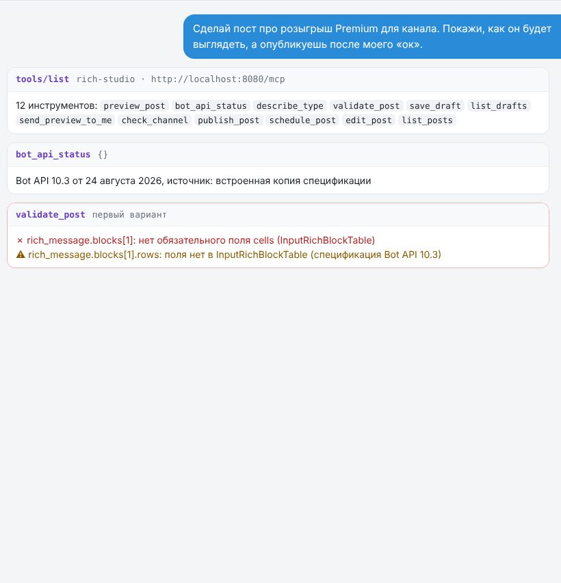

`preview_post` показывает пост прямо в чате так, как его нарисует Telegram (MCP App `ui://rich-studio/preview`, тот же `render.js`), вместе с ошибками проверки. Это работает в клиентах с поддержкой MCP Apps, например в Claude; остальные получают тот же результат текстом. Картинки `upload:<имя>` в чате не загружаются: окно предпросмотра не имеет доступа к сети.

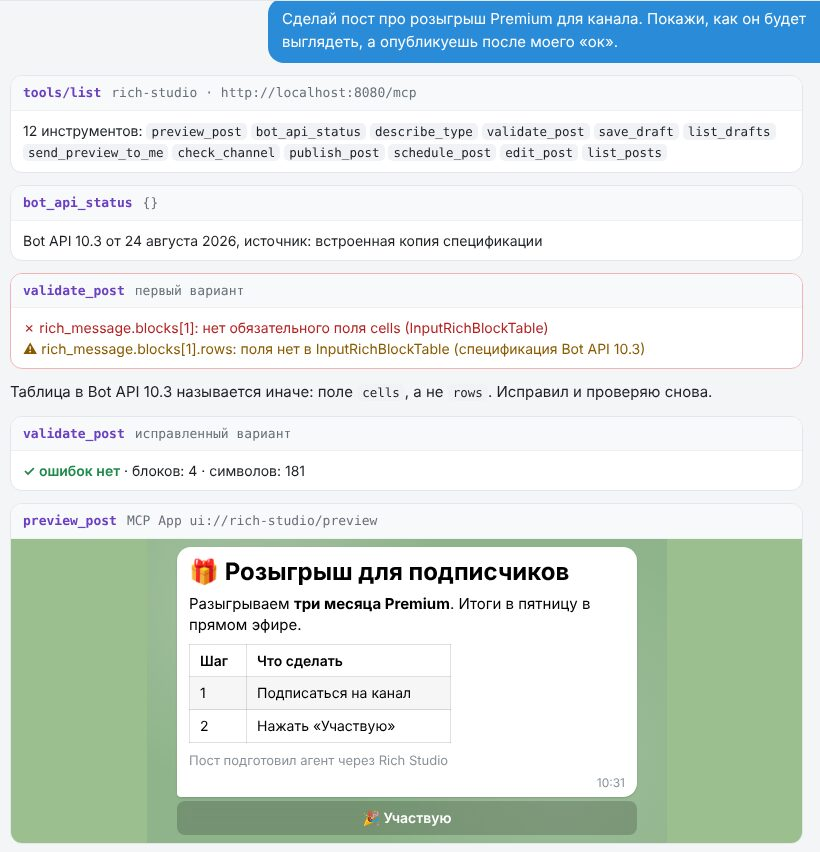

После вашего «ок» агент делает пробную отправку, публикует с ключом повтора, а повтор с тем же ключом не создаёт дубль. В списке постов публикация записана с отметкой `mcp`:

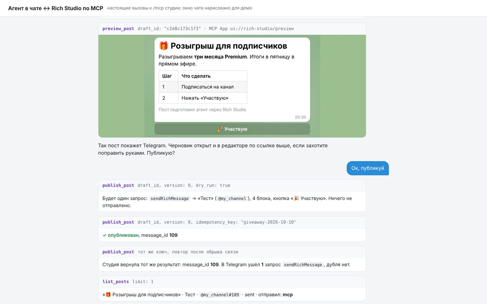

Публикация помечена как действие с внешним эффектом, и клиент обычно спрашивает подтверждение, но это решает клиент, а не студия: если вызов `publish_post` в нём разрешён заранее, агент опубликует без вопроса (в том числе по указке текста, который он прочитал). Чтобы агенты только готовили черновики, а публиковали вы из редактора, задайте `MCP_PUBLISH=off`: тогда `publish_post`, `schedule_post`, `edit_post`, `reschedule_post` и `cancel_scheduled_post` в MCP не появятся. Удаление постов и произвольные методы Bot API (`/api/raw`) через MCP недоступны.

## Skill для Claude Code

`.claude/skills/telegram-rich-posts/SKILL.md`: сначала проверяет актуальную версию Bot API и что изменилось, содержит шпаргалку по блокам, тегам и ограничениям каналов и работает через API студии (проверка → предпросмотр → публикация только после вашего подтверждения). Claude Code, запущенный в папке студии, находит его сам (`/telegram-rich-posts` или просто попросите написать пост). Чтобы он работал и в других проектах, скопируйте папку в `~/.claude/skills/`.

## Бэкап

Всё, что хранит студия (черновики, посты, история правок, счётчики, загруженные файлы), лежит в `./data`. Кнопка «Скачать бэкап» во вкладке «Файлы» (или `GET /api/export`) отдаёт zip: согласованную копию базы `studio.db`, снятую без остановки сервиса, и папку `media/`. Кроме того, раз в сутки студия сама кладёт копию базы в `./data/backups/` и хранит последние 7 (`BACKUP_KEEP`, 0 выключает). Эта копия спасает от случайного удаления или ошибки, но не от потери диска: zip храните в другом месте.

Восстановить: остановите студию (`docker compose down`), распакуйте zip в `./data` с заменой файлов и запустите снова. Копию из `./data/backups/` достаточно положить на место `./data/studio.db`.

Там же, во вкладке «Файлы», файлы без отметки нужности (их нет ни в одном черновике, отложенном, пропущенном или опубликованном посте) можно удалить одной кнопкой «Удалить ненужные».

## Журнал и состояние

Студия следит за собой сама. Журнал пишется в `./data/logs/studio.log` строками JSON (запросы к API, вызовы Bot API, сбои, смены состояния) и не растёт больше 20 МБ: файл до `LOG_MAX_MB` (5) и `LOG_FILES` (3) старых копий. Вывод контейнера ограничен 3 × 10 МБ в `docker-compose.yml`. Токена и текста постов в журнале нет.

`GET /api/health` отвечает, что сломано и что делать: база, место на диске, связь с Telegram, фоновые циклы, застрявшая очередь, не ушедшие и «могли уйти» посты, бэкап, размер данных, ошибки за час. Раз в 5 минут студия сравнивает отчёт с прошлым и пишет каждую смену в журнал, так что видно, когда сломалось и когда починилось. У каждого ответа есть заголовок `X-Request-ID`, и этот же id стоит на всех строках журнала того запроса (можно прислать свой или `traceparent`). Задержки p50/p95 по каждому эндпоинту и методу Bot API — в `metrics` отчёта.

В шапке редактора тот же отчёт виден точкой слева от версии Bot API: зелёная, когда всё в порядке, жёлтая или красная с числом проблем, когда нет. Обновляется раз в минуту, по нажатию открывается список проверок с подсказками.

Для Claude Code: когда сессия открывается в папке студии, хук `SessionStart` (`.claude/hooks/studio_health.py`) одной строкой говорит, если студия не в порядке, и молчит, если всё хорошо. Если студия не запущена или не приняла ключ, строку получает только агент (вам она не показывается): так он знает, почему инструменты `rich-studio` не отвечают. Skill `studio-health` объясняет каждую проверку, субагент `studio-monitor` только читает и коротко докладывает (попросите «проверь студию» или запустите `/loop 30m` с ним). Через MCP то же дают `studio_health` и `studio_logs`. Устройство и планы: [docs/OBSERVABILITY.md](docs/OBSERVABILITY.md).

Уборка раз в час удаляет ключи повтора старше суток. Сделанное вами удаляется, только если вы так настроили: `VERSIONS_KEEP` (сколько версий хранить у поста) и `MEDIA_UNUSED_DAYS` (через сколько дней удалять загрузки, которые ничему не нужны). Без них отчёт просто предупредит, если ненужные файлы занимают больше 200 МБ.

## Безопасность

- Принимаются только запросы с `localhost`/`127.0.0.1` (другие имена добавляются в `ALLOWED_HOSTS`). Запросы с чужих сайтов и не-JSON отклоняются, так что открытая в браузере вкладка не может отправить пост от вашего бота.
- С `STUDIO_API_KEY` все запросы, кроме страницы редактора, требуют заголовок `X-API-Key` (редактор сам запомнит ключ после первого ввода).
- `options` не может переписать `chat_id`, `rich_message`, `reply_markup`, `message_id`. Через `/api/raw` без подтверждения работают только методы, которые читают, отправляют или редактируют сообщения (`get*`, `send*`, `edit*`, `answer*`, `copy*`, `forward*`, закреп и `stopPoll`). Всё остальное, включая `delete*`, `set*`, `logOut` и методы, которые Telegram добавит позже, требует заголовок `X-Confirm: yes`.
- Предпросмотр чистит HTML по белому списку тегов и ссылок, страницы работают под строгим CSP.
- Отложенный пост захватывается атомарно. Если сервис упал во время отправки, пост помечается как «мог уйти» и повторно не отправляется.
- Ответ 5xx или страница ошибки от шлюза Telegram тоже значит «пост мог уйти»: повтора нет ни у планировщика, ни по `Idempotency-Key`. Повторяется только то, что точно не дошло до Telegram: нет соединения или 429.

## Тесты

Одной командой: `make check` (всё ниже плюс проверка слоёв `lint-imports`). Правила для агентов: [AGENTS.md](AGENTS.md).

```
pip install -r requirements-dev.txt
pytest                          # 224 теста API и MCP на подставном Telegram, без сети и токена
ruff check . && ruff format --check . && mypy   # линтер, формат, типы (настройки в pyproject.toml)
npm ci && npm run lint && npm run typecheck   # ESLint и проверка типов редактора; Node нужен только для проверок
npm run test:render             # 43 проверки очистки HTML и разбора Markdown в предпросмотре (Playwright, без студии)
npm run test:parity             # предпросмотр HTML и Markdown против блоков настоящего Telegram (tests/telegram_parse)
npm run test:shots              # примеры из examples/ в обеих темах: вёрстка и скриншоты в test-results/preview/
```

Проверки в браузере (`tests/e2e_ui.mjs`: публикация, закреп, опрос, отмена правок, сверка с Telegram, MCP App, шапка и другие) запускаются против работающей студии, направленной на подставной API из `tests/mock_telegram.py`:

```
make mock    # подставной Telegram на :8081
make dev     # студия на :8080
npm ci && npx playwright install chromium && make e2e
```

Подставной API пригодится и чтобы просто посмотреть студию без настоящего бота. Через `POST http://localhost:8081/push` в него можно подать события от «Telegram» (нажатия, реакции, голоса), как это сделано для скриншотов выше.

## Структура

```
app/main.py        сборка приложения: middleware, роутеры, фоновые циклы
app/settings.py    все настройки из окружения
app/logs.py        журнал с ротацией; app/metrics.py — счётчики для /api/health
app/security.py    защита: Host, CSRF, ключ API, CSP
app/api/           маршруты HTTP (тонкие)
app/mcp_tools/     MCP-сервер для агентов и страница предпросмотра для чата (MCP App)
app/services/      логика: публикация, отложенные посты, события от Telegram, загрузки, ключи повтора
app/telegram/      клиент Bot API без преобразований (+ multipart для upload:)
app/store/         SQLite: черновики, посты, миграции
app/spec/          спецификация Bot API: загрузка, отчёт об изменениях, проверка постов
app/static/        редактор (js/, ES-модули без сборки), рендер предпросмотра (render.js, tg.css), заготовки (snippets.js)
app/static/vendor  KaTeX 0.16.11, markdown-it 14.1.0, @preact/signals-core 1.14.4 (MIT), Lit 3.3.3 (BSD-3), чтобы работало без CDN
app/bundled/       встроенная копия спецификации Bot API 10.3
examples/          примеры постов (HTML и JSON-блоки)
.claude/skills/    skills для Claude Code: посты и здоровье студии (+ субагент в .claude/agents, хуки в .claude/hooks: форматирование, состояние студии при старте сессии)
tests/             тесты API (pytest) и браузера (Playwright)
docs/              устройство кода (ARCHITECTURE.md), наблюдаемость (OBSERVABILITY.md), контракт API (openapi.json), чек-лист ревью, картинки для README
```

Что ещё есть в Bot API для каналов и чего нет: `posting-features.md` в общей папке проекта.
