# Rich Studio

Локальный сервис для постов в Telegram-канал с полным Rich Messages (Bot API 10.4, `sendRichMessage`): визуальный редактор, предпросмотр как в Telegram, публикация в несколько каналов, закреп, первый комментарий, опросы, кнопки с ответами, а также HTTP API, MCP-сервер для AI-агентов и skill для Claude Code.


Все скриншоты ниже сняты с тестового запуска студии на подставном Telegram API (`tests/mock_telegram.py`), примеры запросов и ответов взяты оттуда же. 9 октября 2026 студия прошла прогон на настоящем Bot API в тестовой супергруппе: все примеры, медиа, кнопки, закреп, опросы, замена с историей, отложка, `Idempotency-Key`, `dry_run`, редактор и MCP. Возможности только для каналов (первый комментарий в обсуждении, `members_only` у опроса, закреп в канале) на настоящем канале ещё не проверялись, поэтому первую публикацию сделайте в тестовый канал.

**Содержание:** [что умеет](#что-умеет) · [быстрый старт](#быстрый-старт) · [редактор](#редактор) · [предпросмотр](#предпросмотр) · [публикация и работа с каналом](#публикация-и-работа-с-каналом) · [HTTP API](#http-api) · [MCP для агентов](#mcp-для-claude-и-других-агентов) · [skill](#skill-для-claude-code) · [безопасность](#безопасность) · [тесты](#тесты) · [структура](#структура)

## Что умеет

| Область | Возможности |
|---|---|
| Редактор | все 24 типа блоков Bot API 10.4, форматирование текста, режимы «Визуально», HTML, Markdown, JSON, черновики с автосохранением, шаблоны постов с полями, отмена и возврат правок, черновик из поста, пересланного боту |
| Предпросмотр | вид как в Telegram в светлой и тёмной теме, таблицы, формулы, спойлеры, слайдшоу, карты, кнопки; отдельная страница для ссылки |
| Публикация | сразу, по расписанию, «мне в личку», в несколько каналов, замена текста или только кнопок, удаление; Live Photo и платный контент за звёзды отдельным сообщением |
| Канал | закреп без уведомления, первый комментарий в обсуждении, ответы на callback-кнопки (и rich-ответ, который видит только нажавший), опросы и викторины для каналов, счётчики реакций и нажатий, именные пригласительные ссылки со счётчиком вступлений и платная подписка, предложенные посты от подписчиков |
| Свежесть | редактор строится из машиночитаемой спецификации Bot API, новые поля работают в день релиза |
| Агенты | HTTP API, MCP-сервер на `/mcp` ([инструменты](docs/reference/mcp-tools.md)) с предпросмотром прямо в чате, `dry_run`, `Idempotency-Key`, отметка о том, кто отправил пост |

## Быстрый старт

Нужен Docker (Docker Desktop на Mac/Windows).

```bash
cd rich-studio
cp .env.example .env        # впишите TG_BOT_TOKEN, TG_DEFAULT_CHAT, TG_PREVIEW_CHAT
mkdir -p data               # данные студии; папка ваша, не root
docker compose up -d --build
```

Откройте http://localhost:7424. Документация API: http://localhost:7424/docs (Swagger UI, работает и без интернета).

- **Бот:** токен от [@BotFather](https://t.me/BotFather). В канале сделайте бота админом с правом «Публикация сообщений», для правки ещё «Редактирование сообщений». Кнопка канала в шапке открывает окно «Каналы», где «Проверить» покажет, всё ли в порядке.
- **«Мне в личку»:** в `TG_PREVIEW_CHAT` ваш числовой id ([@userinfobot](https://t.me/userinfobot)); один раз напишите своему боту `/start`. Тот же id включает черновики из постов, которые вы пересылаете боту.
- Сервис слушает только `127.0.0.1:7424` (в контейнере порт 8080). Другой порт: левое число в `ports` в `docker-compose.yml` и `STUDIO_URL` в `.env` и в окружении shell (оттуда адрес берут `.mcp.json` и хук здоровья). Если откроете его в сеть, задайте `STUDIO_API_KEY` или выдайте именные токены (раздел «Доступ» ниже).
- Данные лежат в `./data` (черновики, посты, файлы, кэш спецификации). Обновление: `docker compose up -d --build`.
- Студия в контейнере работает не от root, а от вашего пользователя (`STUDIO_UID`/`STUDIO_GID` в `.env`, по умолчанию 1000:1000; на Linux с другим uid впишите `id -u` и `id -g`). Если `./data` создал Docker или прежний образ от root, студия при запуске скажет об этом; исправить: `sudo chown -R $(id -u):$(id -g) data`. На Docker Desktop (Mac, Windows) это не нужно.
- **На своём сервере** с HTTPS, копией базы в S3 и готовым образом из GHCR: [deploy/README.md](deploy/README.md).

Без Docker: `pip install -r requirements.txt`, затем `cd app && DATA_DIR=../data uvicorn main:app --port 7424` (переменные из `.env` экспортируйте сами).

**Посмотреть студию без бота и токена:** `make mock` и `make dev` в двух терминалах. Студия откроется на http://localhost:7424 и будет «публиковать» в подставной Telegram; так сняты все скриншоты этого файла.

## Как «всегда свежий» устроен

1. **Разметка уходит в Telegram без изменений.** Студия не переводит пост в свои классы, поэтому любой новый тег, блок или поле работает в день релиза, даже если студия о нём не знает (вкладки HTML и JSON, кнопка `{}` у блока, метод `/api/raw/<метод>`).
2. **Редактор строится из спецификации.** Палитра блоков, формы полей, выпадающие списки значений, элементы текста и проверка берутся из машиночитаемой спецификации Bot API ([telegram-bot-api-spec](https://github.com/PaulSonOfLars/telegram-bot-api-spec), пересобирается с core.telegram.org при каждом релизе). Сервис проверяет её при запуске и каждые 12 часов, а кнопка ↻ рядом с версией вверху (или `POST /api/spec/refresh`, или инструмент MCP `refresh_bot_api`) проверяет сразу и показывает версию, изменения и чего не хватает подписям и предпросмотру. Новые блоки появляются в палитре сами, а бейдж версии вверху подсвечивается и показывает, что изменилось. Копию в репозитории (`app/bundled/api.json`) раз в неделю обновляет рутина Claude: `make spec-update`, подписи и отрисовка новых блоков, PR.
3. **Без интернета** работает встроенная копия спецификации 10.4.


Что обновляется вручную: русские подписи блоков и элементов текста (без них показывается имя из спецификации), заготовки HTML-тегов в `app/static/snippets.js` и правила разбора HTML и Markdown в `render.js` (грамматики нет в спецификации; сверяются с настоящим Telegram через `scripts/capture_telegram_parse.py` и `npm run test:parity`; после новой версии Bot API примеры стоит переснять с настоящим ботом), отрисовка новых блоков и элементов текста в предпросмотре (до этого новый блок показывается рамкой с его JSON, а элемент текста пунктирной рамкой) и таблица «блок → HTML» для кнопки «В HTML» в `app/static/js/html-export.js` (до этого кнопка отказывается переводить пост с новым блоком или элементом). Лимиты rich-сообщения (`MAX_*` в `app/spec/validator.py`) взяты из раздела [Rich Message Limits](https://core.telegram.org/bots/api#rich-message-limits) документации: в спецификации их нет. Как Telegram их считает, а также порог, после которого он молча обрезает текст (`MAX_BYTES`), сняты с настоящего Bot API 10.4 (issue #170): после новой версии их стоит перемерить. Там же записано замеренное исключение из спецификации (`NOT_REQUIRED`): ячейку таблицы без `align` и `valign` Telegram принимает, хотя в спецификации они обязательные. И таблица именованных сущностей HTML, которые Telegram разбирает (`TG_ENTITIES`, она же в `render.js`), что он делает с числовыми (`tg_char` и `tgChar` в `render.js`, замер в `tests/telegram_parse/numeric_entities.json`) и с какими символами в адресе выбрасывает ссылку или отклоняет кнопку (`LINK_DROPS` и `BUTTON_REFUSES`, `LINK_DROPS` в `render.js`): это тоже замер Bot API 10.4 16 ноября 2026 (issue #174), после новой версии его стоит повторить. Так же из документации, а не из спецификации, взято окно в 15 секунд для rich-ответа на нажатие (`WINDOW` в `app/services/callbacks.py`, раздел [Ephemeral Messages and Commands](https://core.telegram.org/bots/api#ephemeral-messages-and-commands)). Для rich-ответа вручную названы и поля Bot API: что в ответе запрещено (`FORBIDDEN` и `FORBIDDEN_EPHEMERAL` в `app/services/callbacks.py`: `chat_id`, `business_connection_id`, `allow_paid_broadcast`, `callback_query_id`, `receiver_user_id`) и что правит окно ответа в редакторе (`ephemeral_message_parameters.replace_callback_query_message` в `app/static/js/reply-dialog.js` и в строке карточки в `keyboard.js`); переименует их Telegram — правятся там. Где поле или кнопка не работает (канал, группа, личка, эфемерное сообщение), студия читает из описаний спецификации (`app/spec/chats.py`); вручную там записаны замер (`REFUSED_IN` в `app/spec/validator.py`: что Telegram отклонил на Bot API 10.4 16 ноября 2026 и с каким ответом, в том числе то, чего в спецификации нет; после новой версии стоит перемерить), подсказка про прямую ссылку Mini App для `web_app` (`HINTS`), названия чатов в предупреждениях (`PLACES`, редактор получает их в `GET /api/spec`) и то, что `type` у `<tg-button>` — поле кнопки (`HTML_BUTTON`). Для поста, пересланного боту, вручную записано, какие типы entity Telegram находит в тексте сам и где имя entity расходится с типом RichText (`DETECTED` и `RENAMED` в `app/spec/entities.py`, поле `voice` у Message и действия кнопок, привязанные к боту исходного поста, — `MESSAGE_KEYS` и `BOT_ACTIONS` в `services/forward_import.py`); остальные типы сопоставляются со спецификацией по имени, а незнакомый переносится текстом с предупреждением. Чего из этого не хватает для текущей спецификации, показывает окно спецификации (поле `gaps` в `GET /api/spec`) и проверяет тест `tests/test_spec_coverage.py`.

Что Bot API 10.4 (9 ноября 2026) дал студии: элемент текста «Адрес TON» (`ton_address`) в редакторе и предпросмотре; цитата из rich-поста (`reply_parameters.quote_rich_texts` в `options`) уходит в Telegram как есть. HTML-виджеты (`sendWidget`) в каналы не отправляются, поэтому в редакторе их нет ([0024](docs/decisions/0024-no-widgets-in-editor.md)); их методы, как и любые другие, доступны через `/api/raw`.

На сервере (`STUDIO_MODE=server`) спецификация закреплена (`SPEC_PIN`): студия ничего не скачивает и работает на копии из образа, новая версия приходит с обновлением образа. Ещё вручную: Python-пакеты. Dependabot их не поднимает ([0020](docs/decisions/0020-dependabot-self-contained-prs.md)): поднимите пин в `requirements.txt` или `requirements-dev.txt` (что устарело, покажет `.venv/bin/pip list --outdated`) и выполните `make lock`, он пересобирает `requirements.lock` с хэшами, из которого ставит пакеты образ. Зависимости зависимостей поднимает `make lock LOCK_ARGS=--upgrade`. Swagger UI для `/docs` лежит в студии закреплённой версией и обновляется по заметке `app/static/vendor/swagger-ui/README.md`.

CodeMirror для вкладок HTML, Markdown и JSON лежит в `app/static/vendor/codemirror-<хеш>/`: файлы пакетов из npm как есть, только импорты сделаны относительными ([0017](docs/decisions/0017-codemirror-vendored-modules.md)). `make vendor-update` поднимает его до последних версий. Dependabot его не трогает. `make check` сверяет каталог с `package-lock.json`.

## Редактор

| Вкладка | Что это |
|---|---|
| **Визуально** | Конструктор из блоков (`rich_message.blocks`): заголовки, таблицы с объединением ячеек, списки и чек-листы, цитаты, раскрывашки, коллажи, слайдшоу, карты, кнопки, медиа. Текст с панелью форматирования (выделите текст), через «＋ элемент» вставляются дата-время, кастомные эмодзи, формулы, сноски, якоря, кнопки в тексте, адрес TON и всё остальное из спецификации. |
| **HTML** | Rich HTML с панелью заготовок; ⚠ у кнопки значит, что синтаксис взят из сторонних источников. |
| **Markdown** | Rich Markdown (GFM + разрешённые теги). |
| **JSON** | Весь запрос целиком: `rich_message`, `reply_markup`, `options`. Пост меняется только по «Применить JSON»; неприменённый текст (даже с ошибкой) хранится в черновике и переживает смену вкладки и перезагрузку, но в предпросмотр и отправку не попадает, а у вкладки горит точка. Если пост поменяли после ваших правок JSON, над текстом появляется плашка: «Применить мои» или «Отбросить». |

Вкладки HTML, Markdown и JSON — редактор кода (CodeMirror): подсветка, номера строк, парные скобки и кавычки, поиск и замена (Ctrl+F), своя отмена правок внутри поля (Ctrl+Z, Ctrl+Y; вне поля Ctrl+Z отменяет правку всего поста). Подсказки появляются по ходу набора или по Ctrl+Пробел. В HTML и в тегах внутри Markdown это теги, атрибуты и их значения из заготовок (`app/static/snippets.js`). В JSON это поля поста и любого вложенного типа Bot API из `/api/spec`. Описание поля видно рядом со списком. Для блоков и элементов текста подсказка `"type"` предлагает варианты, а после выбора остаются только поля этого варианта. Галочка «Простой редактор» под полем возвращает обычное поле ввода (если на телефоне сбоит клавиатура) и запоминается. Редактор кода грузится при первом открытии вкладки; если он не загрузился, работает обычное поле, черновик сохраняется как всегда.

Кнопка «В HTML» над блоками переводит визуальный пост в HTML-исходник: его удобно править руками или отдать агенту. Результат попадает во вкладку HTML, и пост дальше отправляется оттуда, а блоки остаются в своей вкладке. Если во вкладке HTML уже был свой текст, студия сначала спросит, заменить ли его (вернуть прежний можно отменой ↶). Медиа из блоков добавляются в «Медиа поста» как `tg://photo?id=…`. Перевод ничего не теряет молча: если в HTML не попадёт поле или блок (например, размер карты) или Telegram прочитает элемент иначе, окно перечислит, что мешает, а вкладка HTML не изменится. Готовый HTML проверяется так же, как предпросмотр: он должен выглядеть как блоки. Несколько пробелов подряд и табуляция в HTML станут одним пробелом, и студия предупредит, где они. Что сделает из HTML сам Telegram, покажет «Мне в личку».

Кнопка «＋ блок» открывает палитру: блоки по группам «Текст / Медиа / Структура / Кнопки» с поиском по названию (новые из спецификации попадают в «Другое»), при наведении видно описание:

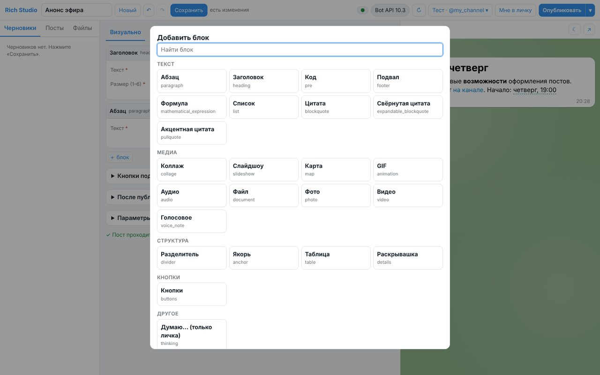

Элементы внутри текста (здесь дата и время с часовым поясом) редактируются в окне, поля которого тоже построены по спецификации. В предпросмотре дата сразу показывается так, как её увидит подписчик:


**Набор текста.**
- Вставка из Google Docs, Notion или браузера сохраняет жирный, курсив, подчёркивание, зачёркивание, код, индексы и ссылки; остальная разметка и скрипты отбрасываются (HTML разбирается в неактивном документе).
- Картинка из буфера или перетащенная с рабочего стола на блок загружается и становится блоком «Фото» (видео, аудио — своими блоками) сразу после него.
- Ctrl+K (или 🔗) ставит ссылку на выделение или в место курсора; внутри ссылки открывает её адрес и текст для правки и кнопку «Убрать ссылку». Адрес без сайта (`https://`) окно не примет, как и Telegram.
- Таблица — сетка из простых полей. Заголовок, выравнивание, объединение ячеек, строки и колонки настраиваются в панели под таблицей для ячейки в фокусе. Таблица из Google Sheets или Excel вставляется в любую ячейку и растягивает сетку.
- Блок переносится стрелками ↑↓ или сразу в начало и конец (⤒ ⤓).

| Ctrl+K: адрес без сайта окно не примет | Таблица: сетка и панель ячейки, три строки вставлены из таблицы |
|---|---|
|  | 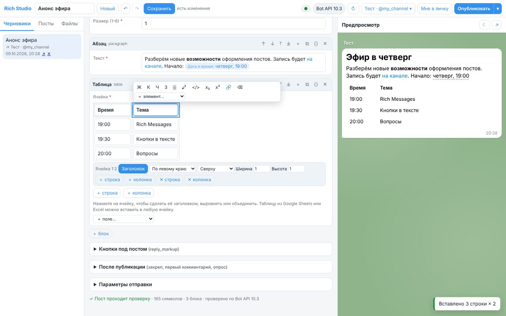 |

Пост из нескольких блоков: заголовок, абзац с жирным текстом и датой, таблица, фото из загрузок и кнопка. Внизу редактора всегда видна проверка по спецификации, а её итог и счётчик символов — рядом со вкладками режимов. Замечание называет блок словами («Раскрывашка №3 › Заголовок: пустой текст») и по нажатию прокручивает к полю и подсвечивает его:


Режим HTML с панелью тегов. У каждого режима свой текст; отправляется тот, что открыт (кроме JSON):


Кнопки ↶ ↷ (или Ctrl+Z и Ctrl+Shift+Z вне текстовых полей) отменяют и возвращают правки всего поста. Здесь три шага назад убрали кнопку, фото и вставленные строки таблицы:


Ниже блоков: медиа поста для HTML/Markdown (ссылки `tg://photo`, `tg://video`, `tg://audio`, `tg://document`; GIF вставляется как видео, голосовое как аудио, вид файла хранит запись; визуальный пост этот список не отправляет, а черновик его хранит), кнопки под постом, панель «После публикации» (закреп, первый комментарий и опрос сразу после поста) и параметры отправки (без звука, защита от пересылки и любые другие параметры `sendRichMessage`).

Слева: черновики (автосохранение), посты (опубликованные и отложенные; открыть, заменить, удалить или отменить) и файлы (загрузка перетаскиванием, кнопка «в пост»).

**Шаблоны постов.** Рубрику (дайджест, анонс) не нужно собирать каждый раз заново. Строка «Шаблоны» над черновиками → «＋ Текущий пост шаблоном»: окно показывает строки поста (текст блоков, ссылки кнопок; в HTML — текст между тегами, адреса в `href`/`src` и `data` у `<tg-button>`), и «→ поле» делает строку полем: в посте встаёт `{{text}}`, а сама строка становится значением по умолчанию. У поля есть подпись, тип (строка, несколько строк, ссылка или файл `upload:имя`) и отметка «обязательное». В HTML можно вписать `{{имя}}` прямо в текст, поле появится само. «Новый пост» у шаблона открывает форму из его полей и создаёт новый черновик без каналов. Значение всегда встаёт как текст: в HTML оно экранируется, в блоках остаётся строкой, поэтому `<b>` или кавычки в нём разметки не создадут. Переменная внутри тега, в атрибуте без кавычек, в ключе JSON и в Markdown не принимается (Markdown: переведите пост в визуальный режим или HTML), в `href` и `src`, а в блоках и кнопках в `url` — только поле типа «ссылка» целиком (`data` у `<tg-button>` — не ссылка, а `callback_data` кнопки, туда подходит и строка), без кусков вроде `https://site/{{slug}}` (там же `#якорь` и `/путь`; файл `upload:` в атрибут HTML и в `url` не подставляется: в HTML-посте он лежит в медиа поста). HTML с полями должен разбираться без ошибок по правилам HTML5, как в браузере: `=` без имени атрибута, лишняя кавычка в теге или `<` вне тега дают отказ. Строки медиа с `parse_mode` или `entities` (подпись, файл) и «Данные для бота» (`callback_data`, в HTML `data` у `<tg-button>`) кнопки, у которой есть ответ на нажатие в `callbacks`, полем не становятся: окно их не предлагает, а сохранение отвечает отказом (ответ ищется по ключу `callbacks`, ключ не заполняется, и кнопка осталась бы без ответа). Кнопок первого комментария, опроса после поста и rich-ответа это не касается: на их нажатия студия не отвечает. Файл шаблона (в посте или как значение по умолчанию) считается нужным: уборка его не удалит, а удаление спросит подтверждение. Агенты работают с шаблонами через MCP (`list_post_templates`, `draft_from_template`) и `/api/templates`.

На телефоне редактор и предпросмотр — две вкладки, шапка переносится в несколько строк:


## Предпросмотр

Предпросмотр справа повторяет вид Telegram в светлой и тёмной теме: таблицы, формулы (KaTeX), спойлеры, свёрнутые цитаты, слайдшоу (листается мышью, стрелками ← → и точками под ним), карта (OpenStreetMap), кнопки. Код-блок как в Telegram Desktop: полоса слева, шапка с языком (без языка — «копировать») и значком копирования, но без подсветки синтаксиса ([почему](docs/decisions/0022-code-block-without-highlighting.md)). GIF из `media` (`InputMediaAnimation`, даже за ссылкой `tg://video`) играет сам по кругу, с меткой «GIF» и без кнопок. Адрес TON, который Telegram сам находит в тексте (HTML, Markdown и строки блоков; только адрес с верной контрольной суммой), выделен цветом ссылки. Предпросмотр изолирован от стилей редактора, ссылки-якоря прокручивают его внутри. Кнопка ↗ открывает пост отдельной страницей.

HTML и Markdown предпросмотр разбирает так же, как настоящий Telegram: спойлер `||текст||`, маркер `==текст==`, формулы `$…$` и `$$…$$`, сноски `[^1]`, таблицы. Правила записаны с настоящего бота: `tests/telegram_parse/captured.json` хранит 35 примеров вместе с блоками, которые вернул Telegram, а `npm run test:parity` проверяет, что предпросмотр рисует их одинаково. После обновления Bot API их стоит записать заново через работающую студию, без токена бота: `STUDIO_URL=http://localhost:7424 PARSE_CHAT=<чат> python scripts/capture_telegram_parse.py` (вызовы идут через `/api/raw`; защищённой студии нужен ещё `STUDIO_TOKEN` уровня `admin`; без `STUDIO_URL` скрипт ходит в Telegram сам с `TG_BOT_TOKEN`). Сообщения уходят без звука и сразу удаляются.

После «Мне в личку» над предпросмотром появляется сверка: Telegram возвращает блоки, на которые разобрал пост, и студия сравнивает с ними свой предпросмотр. «✓ так же» или «≠ иначе» с местом, где они расходятся; кнопка «Как разобрал Telegram» показывает пост из его блоков, а «В визуальный» переносит HTML или Markdown в визуальный режим ровно так, как его понял Telegram (исходный текст остаётся в своей вкладке, медиа ссылаются на уже загруженные в Telegram файлы). Если пост изменился после отправки, сверка просит отправить его ещё раз.

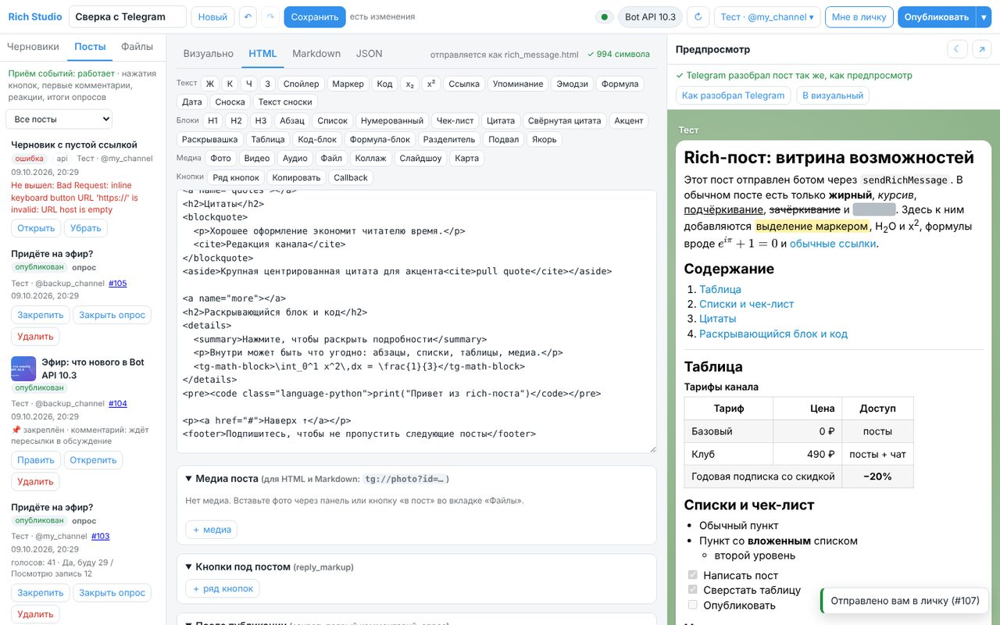

Примеры из папки `examples/`, отрисованные тестом `npm run test:shots`:

| `post-showcase.html`, светлая тема | `post-blocks.json`, тёмная тема |
|---|---|
| 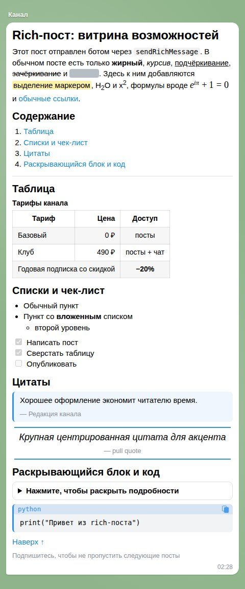 |  |
| **`post-media.html`, светлая тема** | **`post-extras.html`, тёмная тема** |
|  | 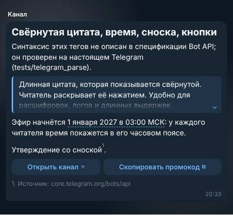 |

Тот же анонс со слайдшоу, картой и кнопками в тёмной теме редактора:


## Публикация и работа с каналом

**Каналы.** Канал принадлежит черновику: он сохраняется вместе с ним, и черновик для канала A, открытый завтра, уйдёт в A, а не туда, куда публиковали последним. Новый черновик начинается с канала по умолчанию (`TG_DEFAULT_CHAT`). В шапке кнопка с названием канала открывает окно «Каналы»: выбрать канал («Сюда»), добавить новый и проверить его. Каналов может быть несколько: в окне «Каналы» их id перечисляются через запятую, и пост уйдёт в каждый. Студия спрашивает у Telegram название и права бота и дальше везде показывает канал как «название · id»: в шапке, в списке черновиков (строка «→ куда»), в списке постов и отложенных, в предпросмотре и в подтверждении публикации. MCP так же называет каналы: `goes_to` в `save_draft`, `list_drafts`, `get_draft`; `chat_title` в `list_posts`, `get_post` и в ответах `publish_post` и `schedule_post`. Для форума рядом с кнопкой появляется выбор темы (`message_thread_id`). Bot API не умеет перечислять темы форума, поэтому новые темы студия запоминает сама, когда видит их создание, а существующие добавляются вручную по номеру из ссылки. Тема принадлежит каналу: при смене канала она снимается, а `message_thread_id` при нескольких каналах или для известного канала-не-форума студия не отправляет (400). Публикация по `draft_id` удалённого черновика без явного `chat_id` тоже даёт 400, а не уходит в канал по умолчанию.

**Проверка бота.** «Проверить» в окне «Каналы» спрашивает у Telegram, админ ли бот в канале и есть ли у него права:

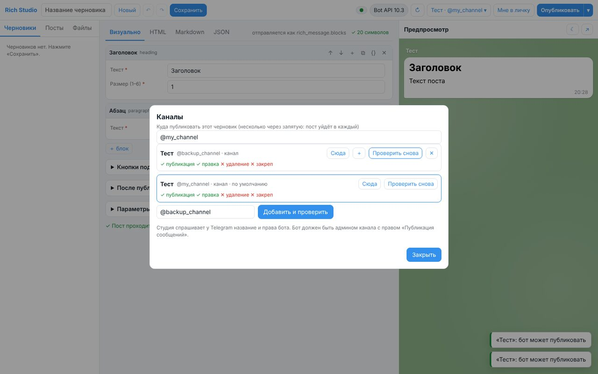

**Пригласительные ссылки.** «Ссылки» у проверенного канала в окне «Каналы». Сделайте отдельную ссылку на каждую площадку, где рассказываете о канале (название видно только админам), и студия покажет, сколько человек вступило по каждой. Ссылка бывает обычной (со сроком и пределом вступлений), по заявке (заявки принимает админ, студия считает и их) и платной подпиской за звёзды на 30 дней (только в канале). Telegram боту таких счётчиков не даёт, поэтому студия считает вступления сама по событиям `chat_member` и `chat_join_request`: нужен включённый приём событий, а вступления, пока студия была выключена больше суток, не посчитаются. Ушедших студия не вычитает: Telegram не говорит, по какой ссылке человек когда-то пришёл. Боту нужно право «Пригласительные ссылки» (`can_invite_users`, в строке прав канала «ссылки»). Через API: `GET/POST/PATCH /api/invite-links`, `POST /api/invite-links/revoke`; в MCP `list_invite_links`, `create_invite_link`, `edit_invite_link`, `revoke_invite_link`.

**Публикация.** «Опубликовать» отправляет пост сразу; в меню «▾» рядом с ней «Отложить…» (по расписанию, с часовым поясом), «Опрос…» и «Заменить пост…». «Мне в личку» отправляет пост вам. Опубликованный пост появляется во вкладке «Посты» с `message_id` и ссылкой:

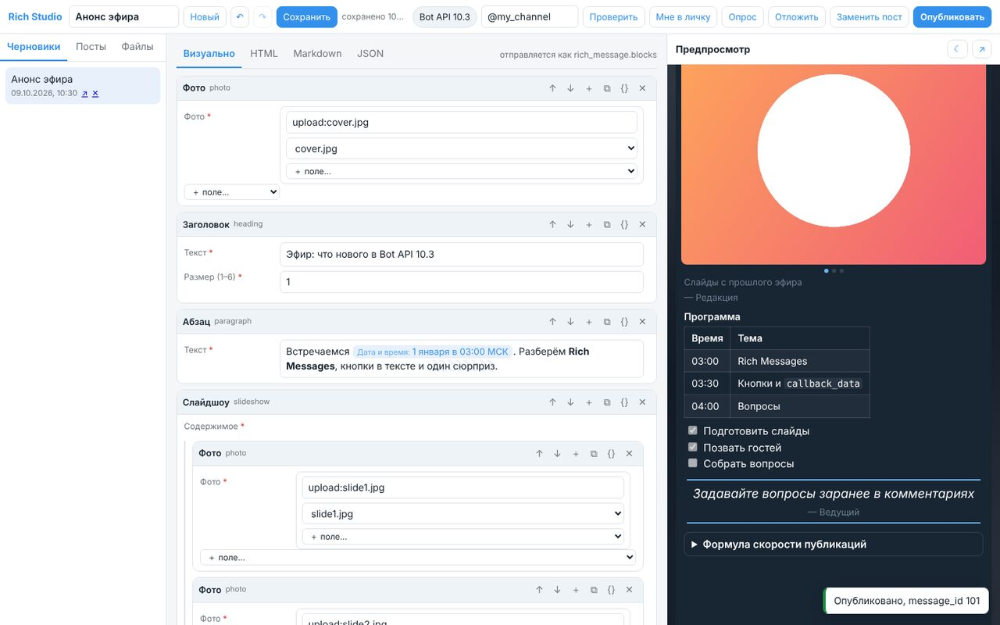

В окне «Отложить» есть быстрые варианты («Через час», «Завтра в 9:00», «В понедельник в 9:00»…), часовой пояс браузера, канал, куда уйдёт пост, и список того, что уже стоит в очереди на неделю. То же окно у «Перенести» и у отложенного опроса.

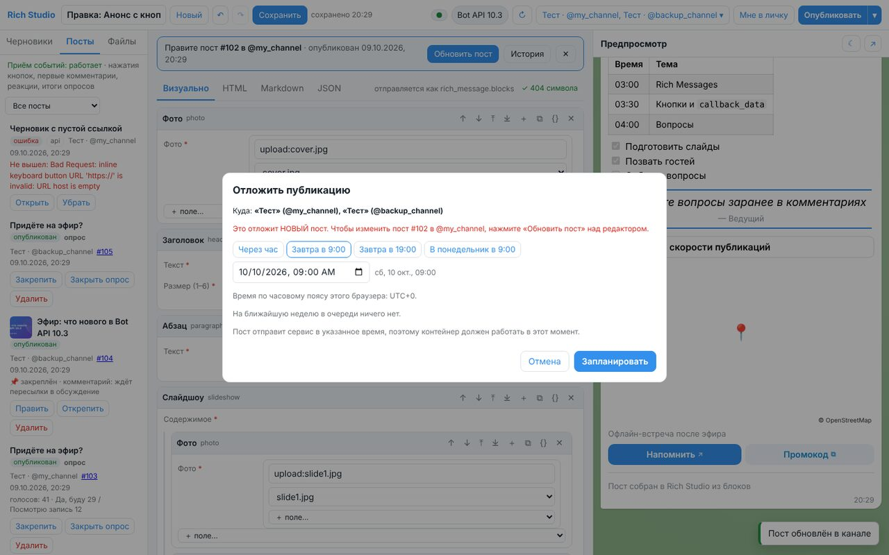

Отложенные посты отправляет сам сервис, поэтому в момент публикации контейнер должен работать. Если он был выключен и пост опоздал больше чем на час (`SCHEDULE_LATE_MIN`), студия его не отправляет, а помечает «пропущен»: утренний анонс, ушедший вечером, хуже, чем никакой. Откройте его и опубликуйте или отложите заново. Если Telegram недоступен (нет сети после сна ноутбука), пост ничего не потерял: студия повторит попытку через минуту, пока не выйдет тот же час. Если отложенный пост или черновик использует файл, удалить файл можно только со второго подтверждения.

Студия рассчитана на один процесс: один контейнер, без `--workers`. Если по ошибке запустить второй (или новый контейнер поднимется раньше, чем остановится старый), он не будет отправлять отложенные посты и принимать события, пока работает первый: `/api/health` покажет это предупреждением в проверке `loops`. При остановке (`docker compose stop`) студия до 10 секунд дожидается открытых запросов, затем не берёт новые отложенные посты и даёт начатым отправкам до 30 секунд. После аварийного перезапуска отложенные посты пойдут не сразу, а через минуту: столько живёт lease упавшего процесса.

**Черновик в двух вкладках.** Новый пост сохраняется черновиком сам, через пару секунд после первой правки. Если тот же черновик сохранили в другой вкладке или агентом, редактор не перезапишет его молча, а спросит: открыть их версию или сохранить свою поверх.

**Пост из Telegram в черновик.** Перешлите боту пост (свой или чужой): он появится в списке черновиков (и в `list_drafts` у агента) с тем же оформлением, а бот поставит на ваше сообщение реакцию ✍. Rich-пост переносится блоками, обычный пост — текстом или подписью с форматированием (жирный, курсив, ссылки, код, спойлеры, цитаты, кастомные эмодзи, дата-время) и своим фото, видео или файлом. Медиа не скачиваются: черновик ссылается на файлы, которые уже лежат в Telegram. Альбом становится одним черновиком с коллажем. Кнопки-ссылки и копирование текста остаются, а кнопки, которые работают только у бота исходного поста (ответ на нажатие, веб-приложение, вход, inline-запрос, игра, оплата), убираются. Содержимое, для которого в rich-посте нет блока (Live Photo переносится как фото, платное медиа, стикер, опрос), не переносится, и это записано в предупреждениях. Канал у такого черновика не задан, в канал ничего не уходит, пока вы его не выберете и не опубликуете; без выбора публикация, как у любого нового черновика, уйдёт в канал по умолчанию. Откуда пост (`forward_origin` и ссылка t.me) и что перенести не удалось, записано в черновике в `_studio.source` и `_studio.warnings`, в Telegram это не уходит. Пересылки принимаются только от вас: в личном чате с ботом, от аккаунта из `TG_PREVIEW_CHAT`; чужие сообщения, группы и ваши обычные сообщения бот, как и раньше, молча пропускает. Если черновик сделать нельзя (защищённое от копирования содержимое; стикер, кружок или опрос, где нечего перенести), бот коротко ответит почему; других сообщений он не шлёт. Нужен приём событий (`TG_UPDATES` не `off`).

**Замечания к черновику.** Служебные поля черновика в `_studio`, которые записал не редактор (например, откуда пост и что не перенеслось при импорте), редактор сохраняет как есть. Предупреждения из `_studio.warnings` видны списком над вкладками редактора; строка «Замечания к черновику» сворачивает его. В Telegram `_studio` не уходит.

**Несколько каналов.** В окне «Каналы» впишите в поле «Куда публиковать» несколько через запятую (`@one, @two`). Пост уйдёт в каждый; если один канал не принял, остальные всё равно получат пост, а ошибка покажется отдельно. Отложка тоже создаётся для каждого канала.


**Кнопки под постом.** Тип кнопки выбирается списком: «Ссылка», «Ответ на нажатие», «Скопировать текст» или «Другое…» (все поля `InlineKeyboardButton` вручную). Для «Ответа на нажатие» студия сама придумывает `callback_data`, вы пишете только текст ответа (всплывающая подсказка или окно). Пустая ссылка у кнопки — ошибка проверки, как и в Telegram. Если действие кнопки не работает в выбранных каналах (например, `web_app` в канале: Mini App открывается только из лички), на карточке кнопки появляется пометка с фразой из спецификации и подсказкой: вместо неё кнопка-ссылка на прямую ссылку Mini App `https://t.me/<бот>/<приложение>?startapp=…`, она работает и из канала. Тип чата студия знает для проверенных каналов (окно «Каналы»).


**Ответы на callback-кнопки.** Студия отвечает на каждое нажатие, даже без заданного текста, иначе кнопка у читателя «крутится». Нажатия считаются в списке постов и подписаны текстом кнопки. Ответ — всплывающая подсказка или окно (`answerCallbackQuery`).

**Rich-ответ на нажатие (Bot API 10.4).** Кнопка «Rich-ответ…» в карточке кнопки открывает окно: HTML ответа, флажок «Показать вместо поста» и предпросмотр. Это целое rich-сообщение, которое увидит только нажавший: студия отправляет его при нажатии (`sendRichMessage` с `ephemeral_message_parameters.callback_query_id`, флажок — `replace_callback_query_message`), а затем, как всегда, отвечает на нажатие. В посте это `callbacks[callback_data].reply` — параметры `sendRichMessage` без чата (решение [0021](docs/decisions/0021-ephemeral-callback-reply.md)). Ответ проверяется как пост при сохранении черновика и перед публикацией; его ошибки видны в проверке внизу редактора и в окне ответа. Telegram принимает такой ответ 15 секунд после нажатия и не обещает доставку. Студия ждёт его не дольше 4 секунд и затем отвечает на нажатие, чтобы кнопка не крутилась. Ответ не повторяется: отказ Telegram (в том числе 429), ответ без подтверждения (сеть, 4 секунды без ответа) и нажатие, которое ждало в студии больше 14 секунд (например, пока студия разбирала очередь после простоя; к концу окна ответ уже не успел бы), пишутся в журнал (`callback.reply_failed`) и в `reply_errors` поста: во вкладке «Посты» рядом с нажатиями стоит «rich-ответ не дошёл: <кнопка> M», а у поста, открытого на правку, карточка кнопки показывает «Нажатий: N · rich-ответ не дошёл M раз» с последней причиной. Ответ проверен на настоящем Telegram (#125). Под постом канала без флажка он приходит отдельным сообщением от бота с пометкой «Видите только Вы», а с флажком встаёт на место поста с пометкой «обновлено» только у нажавшего (в канале пост остаётся исходным) и до перезапуска Telegram (эфемерные сообщения могут исчезать и сами). У замены нет кнопок поста. В личке ответ тоже приходит: без флажка отдельным сообщением, с флажком заменяет сообщение. На нажатие старше окна (например, пока студия стояла) Telegram отвечает `400 query is too old…` и на ответ (`refused`), и на `answerCallbackQuery`.


**Закреп и первый комментарий.** В панели «После публикации». Закреп ставится без уведомления подписчиков, боту нужно право «Редактирование сообщений» (или «Закрепление»). Когда Telegram перешлёт пост в группу обсуждения, студия ответит на него текстом комментария. При `TG_UPDATES=off` студия пересылку не увидит, поэтому сразу предупредит, что комментария не будет; если пересылка не пришла за сутки, комментарий помечается ошибкой. Если студия остановилась или упала, пока отправляла комментарий, он помечается «мог уйти» (проверьте обсуждение) и повторно не отправляется. Пока запрос идёт, во вкладке «Посты» у поста «комментарий: отправляется». Если комментарий никто больше не отправляет, а исход не записан (например, Telegram его принял, а база не приняла запись: `message_id` в журнале, событие `send.unrecorded`), там «комментарий: не подтверждён, мог уйти; не публикуйте заново, проверьте обсуждение»; после перезапуска студии он станет «ошибка». Процесс студии в резерве (фоновые циклы ведёт другой) этого не знает и пишет «отправляется или не подтверждён». Бот должен быть **админом группы обсуждения**, иначе он не видит пересылку. Комментарий виден в предпросмотре под постом, а в «Мне в личку» приходит ответом на пост.


**Опросы.** «Опрос…» в меню «Опубликовать ▾». Викторина с пояснением, несколько ответов, «только подписчики старше суток» (`members_only`), ограничение по странам, описание, автозакрытие, скрытые до закрытия результаты, закреп, отложка; остальные параметры `sendPoll` можно дописать JSON-ом. Кнопка «После поста» прикрепляет опрос к черновику; его же можно составить в панели «После публикации» («Сразу после поста отправить опрос»). Такой опрос сохраняется с черновиком, виден в предпросмотре под постом и уходит в тот же чат и тему сразу, как выйдет пост, в том числе отложенный (в запросе это `poll_after`). Если Telegram опрос не принял, пост остаётся опубликованным, а неудачный опрос появляется в «Постах» с ошибкой.

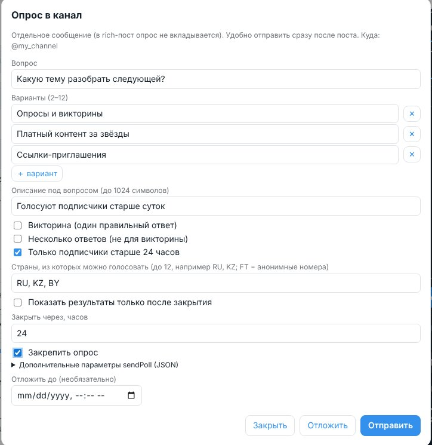

**Live Photo и платный контент.** «Live Photo, платное…» в меню «Опубликовать ▾». В блоках rich-поста таких медиа нет, поэтому это отдельное сообщение, как опрос. Live Photo (`sendLivePhoto`) — короткое видео и кадр из него, оба файла берутся из вкладки «Файлы». Платный контент (`sendPaidMedia`) — до 10 фото, видео и Live Photo под размытием за звёзды; в канале должна быть разрешена публикация платного контента. Оба можно отложить, закрепить и подписать; в «Постах» они помечены «Live Photo» и «за звёзды», заменить их нельзя, только удалить. Через API: `POST /api/media-post` с `kind` (`live_photo` или `paid_media`) и `params` метода как в Bot API; в MCP `send_media_post`. Файлы `upload:<имя>` работают и в полях `photo`, `live_photo`, `thumbnail`, `cover`.

**Предложенные посты.** Если в канале включены личные сообщения, подписчики могут предлагать посты, бесплатно или за звёзды. Студия собирает их над списком во вкладке «Посты» («Предложенные посты: N»): текст, вложения, автор, цена и время, которое выбрал автор. «Опубликовать сейчас» или «В выбранное время» принимает пост (`approveSuggestedPost`; Telegram публикует его сам и списывает с автора цену), «Отклонить» отказывает с комментарием автору. Дальнейшую судьбу (оплачен, возвращён, не удалось) студия узнаёт из служебных сообщений Telegram. Решение уходит в Telegram один раз: если Telegram не ответил, предложение остаётся «принятие отправлено» до его итога, а не отправляется повторно. Если итог не пришёл, проверьте личные сообщения канала и нажмите в окне предложения «Решить снова»: оно вернётся в ожидание сразу, без таймера. Дошедшее решение Telegram, скорее всего, второй раз не примет, а его итог всё равно придёт и обновит состояние. Решить снова может только человек: в редакторе или `POST /api/suggested-posts/{id}/reopen` с уровнем admin. Агент не видит личных сообщений канала, поэтому в MCP этого нет, а токену уровня publish маршрут отвечает 403. Одобрение, которое не прошло из-за нехватки звёзд у автора, можно повторить. Нужны приём событий и бот-админ канала с правами «Личные сообщения канала» и «Публикация сообщений»; предложения, пришедшие, пока студия была выключена больше суток, не появятся. Через API: `GET /api/suggested-posts`, `POST /api/suggested-posts/{id}/approve`, `/decline` и `/reopen`; в MCP `list_suggested_posts`, `approve_suggested_post`, `decline_suggested_post`.

**Обратная связь.** Во вкладке «Посты» видно состояние приёма событий, закреп, реакции, нажатия кнопок, статус первого комментария и итоги опросов (там же «Закрыть опрос»). У поста есть кнопки «Править», «Кнопки» (только у поста, открытого на правку: заменить кнопки на кнопки из редактора через `editMessageReplyMarkup`, текст не меняется), «Закрепить / Открепить» и «Удалить».

**Правка опубликованного поста.** «Править» открывает пост черновиком-копией, а над редактором появляется плашка «Правите пост #N в @канал». Кнопка «Обновить пост» в ней заменяет именно этот пост (`editMessageText`), а «Опубликовать» в шапке предупредит, что выйдет новый пост. Черновик помнит, какой пост он правит, и после перезагрузки плашка вернётся. «История» показывает, как пост выглядел до каждой замены (из редактора, API или агентом): у каждой версии строки, которые она убрала и добавила, и мини-предпросмотр по «Показать»; любую версию можно загрузить в редактор и вернуть в канал. Черновик-копия называется «Правка: <название исходного черновика>», а в списке черновиков видно, какие уже опубликованы или отложены. Отложенный и пропущенный пост тоже обновляются кнопкой «Обновить пост»; отложенный можно «Перенести», пропущенный «Отложить заново» или отменить. Если пост успели изменить в другом месте (агент, другая вкладка), «Обновить пост» скажет об этом и заменит его только после подтверждения. Смена кнопок тоже попадает в «Историю».


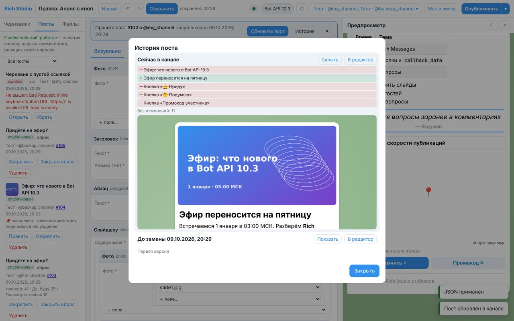

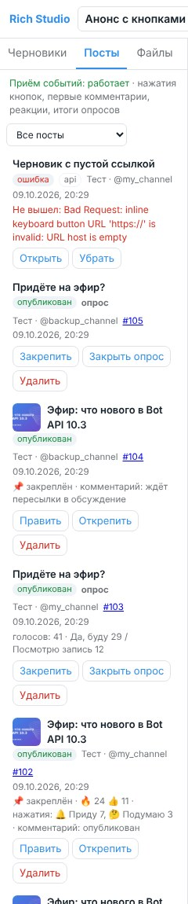

Нажатия, комментарии, реакции, итоги опросов и посты, которые вы пересылаете боту, студия получает сама через `getUpdates`. Если этот же бот уже работает где-то ещё (вебхук или другой процесс с `getUpdates`), будет конфликт: заведите для студии отдельного бота или выключите приём (`TG_UPDATES=off`), тогда остальное работает, а кнопки, комментарии и счётчики нет. Просмотров и охватов Bot API не отдаёт.

## HTTP API

Поле `post` везде одинаковое: `{"rich_message": {...}, "reply_markup": {...}, "options": {...}, "pin": true, "comment": {"html": "..."}, "callbacks": {"like": "Спасибо!"}}`. Последние три поля студия обрабатывает сама и в Telegram их не отправляет. Другие параметры `sendRichMessage` кладите в `options`: поле верхнего уровня, которого у поста нет (`disable_notification` вне `options`), остаётся в посте и черновике, но в Telegram не уходит, а проверка и ответ публикации предупреждают о нём. `chat_id` и `chat_ids` внутри поста — ошибка, как `chat_id` в `options`: каналы задаются рядом с `post` (у `/api/validate` — query-параметр `?chat_ids=`), публикация и предпросмотр с ними отвечают 400, а черновик сохраняется с ошибкой проверки. Ответ на кнопку бывает объектом: поля `answerCallbackQuery` и `reply` с параметрами `sendRichMessage` для rich-ответа нажавшему, например `{"like": {"text": "Ниже", "reply": {"rich_message": {"html": "<p>Только вам</p>"}, "ephemeral_message_parameters": {"replace_callback_query_message": true}}}}`. Файлы из загрузок указываются как `upload:<имя>`.

Все маршруты с описаниями: [docs/reference/http-api.md](docs/reference/http-api.md) (собирается из кода командой `make docs`), интерактивно с примерами: `/docs` работающей студии (Swagger UI из `app/static/vendor/`, без CDN; `/redoc` нет). В защищённой студии `/docs` и `/openapi.json` открываются после входа в редактор (cookie его сессии); «Authorize» на странице принимает токен (`Bearer` или `X-API-Key`), чтобы попробовать запрос от имени другого токена. Ключ, введённый там, живёт только в этой вкладке. Ещё два маршрута без ключа и вне схемы: `GET /healthz` (жив ли процесс) и `GET /readyz` (готова ли студия работать: 503 и имена сбойных проверок).

Время в `/api/schedule` передавайте как unix или ISO 8601 с часовым поясом (`2026-10-10T09:00:00+03:00`). Контракт API записан в `docs/openapi.json`.

### Примеры

Ответы ниже получены на тестовом запуске (`make mock` + `make dev`), длинные поля сокращены.

**Проверка поста.** `/api/validate` проверяет текст, кнопки под постом, первый комментарий и rich-ответы на кнопки (их замечания начинаются с «комментарий:» и «ответ на кнопку «…»:»; ссылка кнопки без адреса вроде `https://` — ошибка: Telegram отклоняет из-за неё весь пост) и [лимиты rich-сообщения](https://core.telegram.org/bots/api#rich-message-limits): до 32 768 символов вместе с `alternative_text` кастомных эмодзи и исходником формул, до 500 блоков (пункты списков и строки таблиц тоже блоки), до 16 уровней вложенности, до 50 медиа и до 20 колонок в таблице (ячейка с `rowspan` в строках ниже колонку не занимает). Как Telegram их считает, замерено на настоящем Bot API 10.4 (issue #170), и превышение — ошибка. Уровни вложенности в посте из блоков — блоки на пути к тексту вместе с блоком, где он лежит, и форматирование вокруг текста; в HTML — элементы на пути к тексту, причём список и таблица — один уровень, текст вне блока и прямо в `<details>` получает ещё неявный абзац, а `<p>` считается уровнем только там же (в `<blockquote>` и `<li>` нет). Ошибку дают только замеренные блоки и теги (абзац, цитата, список, раскрывашка, таблица, `<b>`, `<i>`, `<u>`, `<s>`); заголовок, ссылка, спойлер, `<h1>`, `<a>` и остальное считаются так же, но дают только предупреждение. Ещё одно правило есть только в замере: длинный текст Telegram не отклоняет, а молча обрезает после ~34 990 байт в UTF-8 (буква кириллицы — 2 байта, эмодзи — 4). HTML и Markdown обрезаются по исходнику вместе с разметкой, тегами и адресами ссылок: русский пост из коротких абзацев теряет конец уже на 16–17 тысячах символов. В посте из блоков обрезается каждая строка текста по отдельности, а общий лимит там только 32 768 символов. Студия даёт ошибку, когда исходник HTML или Markdown или одна строка поста из блоков длиннее 34 990 байт. Ссылку, в адресе которой после разбора сущностей есть `"` (в HTML `&quot;`, `&#34;`, `&#x22;`), `<`, `>`, пробел, табуляция или другой управляющий символ, U+0085, неразрывный пробел U+00A0, U+2003, U+3000 или U+200B, Telegram молча выбрасывает и оставляет только текст, и в HTML, и в блоках; U+2028 он из адреса убирает, а ссылку оставляет (предупреждение). Кнопку (`<tg-button>` или кнопку блока «Кнопки», в том числе её `web_app.url` и `login_url.url`) с `"`, `<`, U+00A0 или U+200B он отклоняет вместе с постом (`BUTTON_URL_INVALID`), а пробел и табуляцию в ней кодирует сам. Это ошибки: такие символы в адресе пишите %-кодом (`%22`, `%20`), так же их пишет «В HTML». Без замера только предупреждение «не замерено»: остальные пробелы Unicode в любом адресе, а в кнопке ещё `>`, управляющие символы, U+0085, U+2003 и U+3000. Кнопки под постом (`reply_markup`) на эти символы не проверяются: их не замеряли. `upload:<имя>` в адресе ссылки или кнопки и в атрибуте HTML (`href`, `src`) — ошибка: файл студия подставляет только в поле файла (`media` блока или поста), а там Telegram получил бы `upload:` как есть. Из именованных сущностей HTML Telegram и в HTML, и в Markdown понимает ровно 16: `&amp;` `&apos;` `&copy;` `&gt;` `&hellip;` `&ldquo;` `&lsquo;` `&lt;` `&mdash;` `&nbsp;` `&ndash;` `&quot;` `&rdquo;` `&reg;` `&rsquo;` `&trade;`, плюс числовые (`&#160;`, `&#x2014;`, с маленькой x, цифр сколько угодно). Числовые он читает по-своему, не как браузер: `&#0;`…`&#31;` дают пробел (только `&#10;` в `<pre>` остаётся переводом строки), `&#128;`…`&#159;` — те же коды, а не символы windows-1252 (`&#128;` не «€»), а с суррогатом (`&#xD800;`) или числом больше U+10FFFF Telegram стирает весь текст до ближайшего тега и отклоняет пост, если заголовок или цитата остались без текста: это ошибка проверки. В Markdown так же, но в блоке кода (```` ``` ```` или с отступом) и в адресе ссылки сущности остаются как написаны; внутри `` `кода` `` замера нет, там только предупреждение. Остальные (`&laquo;`, `&euro;`, `&NBSP;`, `&nbsp` без точки с запятой, `&#X22;`) остаются в тексте как написаны, а в адресе ссылки Markdown сущности не разбираются вовсе. Так же их считает проверка и показывает предпросмотр. HTML и Markdown Telegram разбирает в блоки сам: символы студия для них оценивает (ошибка, когда текста заведомо больше лимита, иначе предупреждение), байты исходника считает точно, вложенность считает только в HTML, а блоки и колонки, как и вложенность в Markdown, проверит Telegram при отправке. Ошибка в названии поля таблицы находится до отправки:

```bash
curl -s localhost:7424/api/validate -H 'content-type: application/json' \
  -d '{"rich_message": {"blocks": [{"type": "table", "rows": []}]}}'
```
```json
{"ok": false,
 "errors": ["rich_message.blocks[0]: нет обязательного поля cells (InputRichBlockTable)"],
 "warnings": ["rich_message.blocks[0].rows: поля нет в InputRichBlockTable (спецификация Bot API 10.4)"],
 "stats": {"blocks": 1, "depth": 1, "chars": 0, "max_string_bytes": 0, "media": 0}, "spec_version": "Bot API 10.4"}
```

**Что не работает в чате назначения.** Для проверенных каналов (окно «Каналы», `POST /api/channels`) проверка знает тип чата и предупреждает о том, что Telegram в нём не примет. Правила студия читает из описаний полей спецификации, а не из своего списка ([0023](docs/decisions/0023-chat-type-rules-from-descriptions.md)), и из замера. Замерено на Bot API 10.4 (16 ноября 2026, канал и супергруппа-форум), и каждый раз Telegram отклонял весь пост: и в канале, и в супергруппе — кнопка `web_app` (под постом и в блоке «Кнопки»), кнопка `callback_game`, `message_effect_id`, блок `thinking` (`<tg-thinking>`); только в канале — кнопки `switch_inline_query`, `switch_inline_query_current_chat` и `switch_inline_query_chosen_chat` (под постом и в блоке «Кнопки»), reply-клавиатура, `remove_keyboard` и `ForceReply`. У кнопок `switch_inline_query`, `switch_inline_query_chosen_chat` и `callback_game` в спецификации об этом ничего нет, их знает только замер. Такое предупреждение говорит «Telegram отклоняет пост … (замер …)». Остальные предупреждения взяты только из описаний («в спецификации: …»): например, `request_contact` и другие кнопки reply-клавиатуры — только в личке, `suggested_post_parameters` — только в чате личных сообщений канала. Первый комментарий проверяется для группы обсуждения, rich-ответ на кнопку — как эфемерное сообщение (по спецификации `login_url` и `web_app` в нём не работают) и вдобавок для чата поста, где его показывают. `/api/validate` и `validate_post` принимают `chat_ids` (без них — канал по умолчанию; неверный id просто пропускается), `save_draft` и `preview_post` берут каналы черновика, публикация возвращает те же предупреждения. Это предупреждения: пост уходит как есть, последнее слово за Telegram.

**Пробная отправка.** `"dry_run": true` показывает запросы, которые уйдут в Telegram, ничего не отправляя и не записывая:

```bash
curl -s localhost:7424/api/send -H 'content-type: application/json' -d '{
  "post": {"rich_message": {"blocks": [
    {"type": "heading", "size": 1, "text": "Анонс эфира"},
    {"type": "paragraph", "text": ["Начало в ", {"type": "bold", "text": "19:00"}]}]}},
  "chat_id": "@my_channel", "dry_run": true}'
```
```json
{"dry_run": true,
 "requests": [{"method": "sendRichMessage",
               "params": {"chat_id": "@my_channel", "rich_message": {"blocks": ["…те же блоки…"]}}}],
 "after_send": [], "warnings": []}
```

**Публикация без дублей.** Тот же запрос без `dry_run`, с ключом повтора и подписью отправителя. Повтор с тем же ключом (например, после таймаута) вернул тот же `message_id` 101, а подставной Telegram получил ровно один `sendRichMessage`:

```bash
curl -s localhost:7424/api/send -H 'content-type: application/json' \
  -H 'Idempotency-Key: anons-0910' -H 'X-Studio-Client: script:cron' -d '{"post": {…}, "chat_id": "@my_channel"}'
```
```json
{"post": {"id": "cb5e7c0de590", "chat_id": "@my_channel", "message_id": 101,
          "status": "sent", "actor": "script:cron", "…": "…"}}
```

Правила для этих заголовков у `/api/send`, `/api/schedule` и `/api/poll`:
- `Idempotency-Key`: повтор с тем же ключом вернёт первый результат, а не опубликует пост второй раз. Если первая попытка оборвалась посреди отправки («пост мог уйти»), повтор вернёт ту же ошибку: проверьте канал и только потом отправляйте с новым ключом. Ключ успешного запроса живёт сутки, а ключ «мог уйти» не истекает: повтор с ним ответит той же ошибкой и через неделю. Если сервис упал посреди запроса, повтор с тем же ключом тоже ответит «пост мог уйти». Если пост ушёл, а студия не смогла его записать (502 «не публикуйте повторно», см. раздел «Безопасность»), повтор с тем же ключом вернёт тот же ответ;
- `X-Studio-Client` (например, `mcp:claude-code`): записывается в историю постов, во вкладке «Посты» видно, что пост отправил не редактор;
- `"dry_run": true` в теле `/api/send` и `/api/schedule`: проверка и список запросов без отправки и без записи в историю.
- `draft_id` черновика-правки (у него есть `post_id`) `/api/send` и `/api/schedule` не публикуют: ответ 409 с адресом `/api/posts/{id}/edit`, чтобы правка не ушла в канал вторым постом. Выпустить её копией можно только явно, с `"as_new": true`; так делает кнопка «Опубликовать» в редакторе после предупреждения.

**Проверка канала:**

```bash
curl -s -X POST 'localhost:7424/api/check?chat_id=@my_channel'
```
```json
{"bot": {"id": 42, "username": "studio_test_bot"},
 "chat": {"id": -1001, "title": "Тест", "type": "channel", "username": null},
 "status": "administrator", "rights": {"can_post_messages": true, "can_edit_messages": true}, "can_post": true}
```

Проверка запоминает канал в списке «Каналы», поэтому это `POST` (токену нужен уровень `draft`): `GET` в студии ничего не меняет, и картинка или ссылка в чужом посте проверку не запустит.

## MCP для Claude и других агентов

Студия сама работает как MCP-сервер по адресу `http://localhost:7424/mcp` (Streamable HTTP). Claude Code, открытый в папке студии, подключает его сам из `.mcp.json` (при первом запуске спросит разрешение; адрес берётся из переменной `STUDIO_URL`, по умолчанию `http://localhost:7424`, токен агента — из `STUDIO_TOKEN`, ключ — из `STUDIO_API_KEY`, поэтому экспортируйте их в shell). `STUDIO_URL` пишите без `/` в конце, а для адреса по умолчанию снимите её (`unset STUDIO_URL`): пустое значение даёт пустой адрес. Агент получает и публикующие инструменты; чтобы он только готовил черновики, задайте `MCP_PUBLISH=off` (ниже). Из других папок подключение вручную:

```
claude mcp add --transport http rich-studio http://localhost:7424/mcp
# если студия защищена: именной токен агента (make token NAME=… LEVEL=…) или STUDIO_API_KEY
claude mcp add --transport http rich-studio http://localhost:7424/mcp --header "Authorization: Bearer <токен>"
```

Инструменты с описаниями: [docs/reference/mcp-tools.md](docs/reference/mcp-tools.md) (собирается из кода командой `make docs`). Главные: `save_draft` (сразу возвращает проверку), `preview_post` (предпросмотр в чате), `publish_post` и `schedule_post` (с `idempotency_key` и `dry_run`), `edit_post` (с версией поста из `get_post`), `list_posts`, `studio_health`.

Ответы `save_draft`, `preview_post` и `get_draft` содержат `editor_url` (черновик в редакторе, `/?draft=<id>`) и `preview_url`, `get_post` даёт `editor_url` вида `/?post=<id>`, который открывает пост на правку. Адрес берётся из `STUDIO_URL` (по умолчанию `http://localhost:7424`). Открытый в редакторе черновик, который поменял агент, обновляется сам через несколько секунд. Если в редакторе есть несохранённые правки, он спросит, чью версию оставить.

Агент передаёт JSON поста один раз, в `save_draft`; дальше `preview_post`, `publish_post` и `schedule_post` берут пост по `draft_id`. Публикация по `draft_id` требует `version`, которую вернул `preview_post`, и откажет, если вы успели изменить черновик в редакторе после предпросмотра. Черновик-правка опубликованного поста уходит только через `edit_post` с `draft_id`, вторым постом в канал он не попадёт.

Агент продолжает вашу работу, а не плодит копии: читает черновик (`get_draft`) и сохраняет его же; перед заменой поста читает его (`get_post`), а прежняя версия остаётся в истории. Если агент не передал `idempotency_key`, ключом считается сам запрос: повтор того же поста в тот же канал в течение суток не опубликует его второй раз.

Пост по рубрике агент собирает из вашего шаблона: `list_post_templates` → `draft_from_template` с значениями полей и `version` шаблона даёт новый черновик (с проверкой и `editor_url`), дальше всё как с обычным черновиком. `save_post_template` сохраняет пост шаблоном с полями `{{key}}`.

Как это выглядит в работе. Вызовы и ответы ниже настоящие (тестовый запуск студии), а окно чата нарисовано для демонстрации. Агент проверяет пост, сам исправляет ошибку, на которую указала студия, и сохраняет черновик (`save_draft` сразу возвращает проверку и ссылку на черновик в редакторе):


`preview_post` по `draft_id` показывает пост прямо в чате так, как его нарисует Telegram (MCP App `ui://rich-studio/preview`, тот же `render.js`), вместе с ошибками проверки. Это работает в клиентах с поддержкой MCP Apps, например в Claude; остальные получают тот же результат текстом. Картинки `upload:<имя>` в чате не загружаются: окно предпросмотра не имеет доступа к сети.

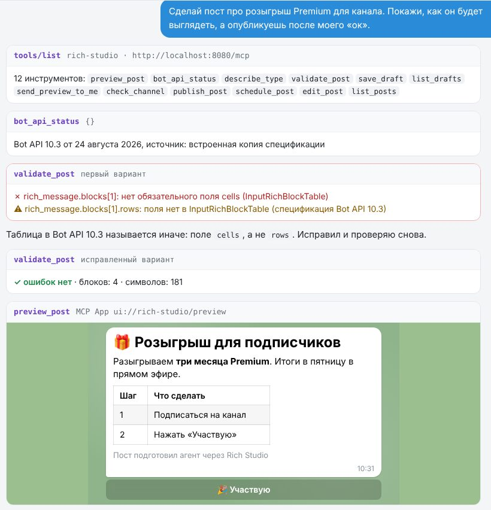

После вашего «ок» агент делает пробную отправку и публикует черновик по `draft_id` и `version` из предпросмотра с ключом повтора; повтор с тем же ключом не создаёт дубль. В списке постов публикация записана с отметкой `mcp`:


Публикация помечена как действие с внешним эффектом, и клиент обычно спрашивает подтверждение, но это решает клиент, а не студия: если вызов `publish_post` в нём разрешён заранее, агент опубликует без вопроса (в том числе по указке текста, который он прочитал). Чтобы агенты только готовили черновики, а публиковали вы из редактора, задайте `MCP_PUBLISH=off`: тогда `publish_post`, `schedule_post`, `send_poll`, `edit_post`, `reschedule_post` и `cancel_scheduled_post` в MCP не появятся. Удаление постов и произвольные методы Bot API (`/api/raw`) через MCP недоступны.

## Skill для Claude Code

`.claude/skills/telegram-rich-posts/SKILL.md`: сначала проверяет актуальную версию Bot API и что изменилось, содержит шпаргалку по блокам, тегам и ограничениям каналов и работает через API студии (проверка → предпросмотр → публикация только после вашего подтверждения). Claude Code, запущенный в папке студии, находит его сам (`/telegram-rich-posts` или просто попросите написать пост). Чтобы он работал и в других проектах, скопируйте папку в `~/.claude/skills/`.

Агент, у которого есть только MCP студии (студия на сервере, Claude Code в другой папке, другие клиенты), получает этот же файл от самой студии: ресурс `skill://telegram-rich-posts/SKILL.md` (по соглашению MCP о skills, [SEP-2640](https://modelcontextprotocol.io/seps/2640-skills-extension)) и prompt `telegram-rich-posts`. Инструкции сервера говорят агенту прочитать ресурс перед постом, если такого skill у него нет; в Claude Code его можно упомянуть как `@rich-studio:skill://telegram-rich-posts/SKILL.md` или вызвать командой `/rich-studio:telegram-rich-posts`. Это не копия: студия отдаёт `.claude/skills/telegram-rich-posts/SKILL.md` как есть, образ кладёт его рядом с приложением, тест сверяет побайтно. Доступ тот же, что к инструментам: у защищённой студии только с токеном или ключом, хватает уровня `read`.

## Бэкап

Всё, что хранит студия (черновики, посты, история правок, счётчики, загруженные файлы), лежит в `./data`. Кнопка «Скачать бэкап» во вкладке «Файлы» (или `GET /api/export`) отдаёт zip: согласованную копию базы `studio.db`, снятую без остановки сервиса, и папку `media/`. Кроме того, раз в сутки студия сама кладёт копию базы в `./data/backups/` и хранит последние 7 (`BACKUP_KEEP`, 0 выключает). Эта копия спасает от случайного удаления или ошибки, но не от потери диска: zip храните в другом месте.

Восстановить: остановите студию (`docker compose down`), распакуйте zip в `./data` с заменой файлов и запустите снова. Копию из `./data/backups/` достаточно положить на место `./data/studio.db`. В обоих случаях сначала удалите `./data/studio.db-wal` и `./data/studio.db-shm`, если они есть: иначе SQLite применит к восстановленной базе журнал от старой.

Там же, во вкладке «Файлы», файлы без отметки нужности (их нет ни в одном черновике, отложенном, пропущенном или опубликованном посте) можно удалить одной кнопкой «Удалить ненужные».

## Журнал и состояние

Студия следит за собой сама. Журнал пишется в `./data/logs/studio.log` строками JSON (запросы к API, вызовы Bot API, сбои, смены состояния) и не растёт больше 20 МБ: файл до `LOG_MAX_MB` (5) и `LOG_FILES` (3) старых копий. Вывод контейнера ограничен 3 × 10 МБ в `docker-compose.yml`. Токена и текста постов в журнале нет.

`GET /api/health` отвечает, что сломано и что делать: база, место на диске, связь с Telegram, фоновые циклы, застрявшая очередь, не ушедшие и «могли уйти» посты, бэкап, размер данных, ошибки за час. Раз в 5 минут студия сравнивает отчёт с прошлым и пишет каждую смену в журнал, так что видно, когда сломалось и когда починилось. У каждого ответа есть заголовок `X-Request-ID`, и этот же id стоит на всех строках журнала того запроса (можно прислать свой или `traceparent`). Задержки p50/p95 по каждому эндпоинту и методу Bot API — в `metrics` отчёта.

В шапке редактора тот же отчёт виден точкой слева от версии Bot API: зелёная, когда всё в порядке, жёлтая или красная с числом проблем, когда нет. Обновляется раз в минуту, по нажатию открывается список проверок с подсказками.


Для Claude Code: когда сессия открывается в папке студии, хук `SessionStart` (`.claude/hooks/studio_health.py`) одной строкой говорит, если студия не в порядке, и молчит, если всё хорошо. Если студия не запущена или не приняла ключ, строку получает только агент (вам она не показывается): так он знает, почему инструменты `rich-studio` не отвечают. Skill `studio-health` объясняет каждую проверку, субагент `studio-monitor` только читает и коротко докладывает (попросите «проверь студию» или запустите `/loop 30m` с ним). Через MCP то же дают `studio_health` и `studio_logs`. Устройство и планы: [docs/OBSERVABILITY.md](docs/OBSERVABILITY.md).

Уборка раз в час удаляет ключи повтора успешных запросов старше суток; ключи «мог уйти» остаются, чтобы повтор с ними не опубликовал пост второй раз. Сделанное вами удаляется, только если вы так настроили: `VERSIONS_KEEP` (сколько версий хранить у поста) и `MEDIA_UNUSED_DAYS` (через сколько дней удалять загрузки, которые ничему не нужны). Без них отчёт просто предупредит, если ненужные файлы занимают больше 200 МБ.

## Безопасность

- Принимаются только запросы с `localhost`/`127.0.0.1` (другие имена добавляются в `ALLOWED_HOSTS`). Запросы с чужих сайтов и не-JSON отклоняются, так что открытая в браузере вкладка не может отправить пост от вашего бота.
- **Доступ.** Пока не задан `STUDIO_API_KEY` и нет ни одного токена, студия открыта, как локальный инструмент. Иначе каждый запрос, кроме страницы редактора и `/healthz`/`/readyz`, должен прийти с ключом или токеном: `Authorization: Bearer <токен>` или `X-API-Key`. Токены именные, у каждого свой уровень: `read` (только читать), `draft` (черновики, файлы, проверка канала, предпросмотр себе в личку; предпросмотр в другой чат уже требует `publish`), `publish` (публиковать, откладывать, заменять, удалять посты), `admin` (ещё `/api/raw` и скачивание бэкапа). `STUDIO_API_KEY` равен `admin`. Выдать: `make token NAME=claude-laptop LEVEL=draft` (токен печатается один раз, хранится только хэш), список: `make tokens`, отозвать: `make token-revoke NAME=claude-laptop` (заодно закрывает его сессии в редакторе). В контейнере: `docker compose exec rich-studio python cli.py token add claude-laptop --level draft`. Отзыв последнего токена студию не открывает.
- В историю постов пишется имя токена (`claude-laptop`, с заголовком `X-Studio-Client: mcp:claude` — `mcp:claude@claude-laptop`), так что видно, какой агент что опубликовал. Инструменты MCP проверяют уровень токена: агенту с `draft` публикующие инструменты ответят ошибкой. `MCP_PUBLISH=off` по-прежнему убирает их у всех. Для Claude Code токен кладётся в переменную `STUDIO_TOKEN`: `.mcp.json` передаёт её сам.
- Редактор спрашивает ключ или токен один раз и меняет его на cookie сессии (`HttpOnly`, `SameSite=Strict`, `Secure` по HTTPS, `SESSION_DAYS` дней): скрипты страницы ключа не видят. Сессия, открытая по `STUDIO_API_KEY`, кончается, когда ключ меняют или убирают. Выйти: `DELETE /api/session`.
- `/api/raw` доступен только уровню `admin`; `RAW_API=off` выключает его совсем.
- Токен бота (и с `%3A` вместо `:`), `STUDIO_API_KEY` и токены `rs_…` маскируются в журнале, `/api/health`, ответах API об ошибках, `posts.error`, ошибках MCP и `/api/updates`: прокси, неверный `TG_API_BASE` или свой сервер Bot API могут вернуть URL с токеном в тексте ошибки. Подробно: [OBSERVABILITY.md](docs/OBSERVABILITY.md).
- Настройки проверяются при запуске: неверные значения перечисляются разом, и студия не стартует. Секреты можно передать файлами: `TG_BOT_TOKEN_FILE`, `STUDIO_API_KEY_FILE`. С `STUDIO_MODE=server` студия не стартует без токена или ключа, без `https://` в `STUDIO_URL` и без токена бота, а `STUDIO_API_KEY` там должен быть не короче 32 символов (`python -c 'import secrets;print(secrets.token_urlsafe(32))'`): неудачные попытки ключа не считаются, от перебора защищает только длина. Именные токены и так длинные.
- `DEADMAN_URL` (healthchecks.io и похожие): студия пингует его раз в 5 минут, `…/fail` при отчёте `fail`; если пинги пропали, внешний сервис напишет вам.
- `options` не может переписать `chat_id`, `rich_message`, `reply_markup`, `message_id` и не может задать `ephemeral_message_parameters`: с ним пост увидел бы один человек, а студия записала бы его постом канала (rich-ответ на нажатие задаётся в `callbacks[…].reply`). Через `/api/raw` без подтверждения работают только методы, которые читают, отправляют или редактируют сообщения (`get*`, `send*`, `edit*`, `answer*`, `copy*`, `forward*`, закреп, `stopPoll` и `setMessageReaction`). Всё остальное, включая `delete*`, `set*`, `logOut` и методы, которые Telegram добавит позже, требует заголовок `X-Confirm: yes`.
- Предпросмотр чистит HTML по белому списку тегов и ссылок, страницы работают под строгим CSP. Редактор, предпросмотр и `/docs` грузят только скрипты студии: без CDN и inline-скриптов. С адреса самой студии картинка или видео поста грузится только из `/media/` (`` снимается), а `GET` в студии ничего не меняет. Значок «копировать» у кода кладёт в буфер то, что видно: не текст из закрытого `<details>` или внутри `<video>`.
- Отложенный пост захватывается атомарно. Если сервис упал во время отправки, пост помечается как «мог уйти» и повторно не отправляется; так же опрос после поста. Такая запись («Исход неизвестен» во вкладке «Посты») не пропадает и после успешной отправки того же черновика, а `/api/health` показывает её, пока вы не проверите канал и не нажмёте «Убрать». Первый комментарий, оборванный так же, тоже не повторяется: пост остаётся отправленным, у него «комментарий: ошибка» с «мог уйти» в тексте, и `/api/health` показывает это сутки. Посмотрите обсуждение и, если комментария там нет, опубликуйте его вручную в Telegram; «Убрать» здесь не нужно: у отправленного поста оно удаляет сам пост из канала.
- Ответ 5xx или страница ошибки от шлюза Telegram тоже значит «пост мог уйти»: повтора нет ни у планировщика, ни по `Idempotency-Key`. Повторяется только то, что точно не дошло до Telegram: нет соединения или 429.
- Telegram принял пост, а студия не смогла его записать (диск полон, база только для чтения): ответ 502 «опубликован, студия не смогла записать — не публикуйте повторно» с `chat_id` и `message_id` в `detail`, тот же ответ на повтор с тем же ключом; в рассылке такой канал — `ok: true, unrecorded: true` и предупреждение, а следующие каналы, для которых студия уже не смогла записать строку, — «не отправлено» (туда ничего не уходит). `message_id` есть и в журнале (событие `send.unrecorded`). Студия допишет запись сама при следующей отправке или проходе планировщика, как только база снова примет её; пока пост висит в `sending`, и `/api/health` показывает его с `message_id`. Закреп, первый комментарий и опрос после такого поста не делаются. Если студию перезапустили раньше, пост станет «Исход неизвестен», и повтор с ключом скажет об этом. Сбой шагов после записи (убрать прежние отказы, закреп, прочитать запись, названия каналов, сохранить ответ для `Idempotency-Key`) — предупреждение в ответе 200, а не ошибка.

## Тесты

Одной командой: `make check` (всё ниже плюс проверка слоёв `lint-imports`). Правила для агентов: [AGENTS.md](AGENTS.md).
Между шагами хватает `make check-fast` (без браузера). Если есть `.venv`, `make` берёт Python оттуда; в облачной сессии Claude Code его и `node_modules` готовит хук `.claude/hooks/session-start.sh`.

CI на каждый PR: тесты и линтеры, браузерные проверки, аудит зависимостей (`pip-audit`, `npm audit`), поиск секретов (gitleaks), сборка и запуск образа с проверкой Trivy. Раз в неделю по расписанию тот же аудит и Trivy идут на `main`: так видна CVE, вышедшая без единого push. Dependabot раз в месяц предлагает инструменты разработки, digest базового образа и actions, раз в неделю Caddy и Litestream для сервера; Python-пакеты и CodeMirror обновляются вручную ([0020](docs/decisions/0020-dependabot-self-contained-prs.md)).

```
pip install -r requirements-dev.txt
pytest                          # 312 тестов API и MCP на подставном Telegram, без сети и токена
ruff check . && ruff format --check . && mypy   # линтер, формат, типы (настройки в pyproject.toml)
npm ci && npm run lint && npm run typecheck   # ESLint и проверка типов редактора; Node нужен только для проверок
npm run test:render             # 43 проверки очистки HTML и разбора Markdown в предпросмотре (Playwright, без студии)
npm run test:parity             # предпросмотр HTML и Markdown против блоков настоящего Telegram (tests/telegram_parse)
npm run test:shots              # примеры из examples/ в обеих темах: вёрстка и скриншоты в test-results/preview/
npm run test:export             # «В HTML»: блоки настоящего Telegram из tests/telegram_parse → HTML → тот же пост; нужен Python студии (PYTHON=…)
```

Проверки в браузере (`tests/e2e_ui.mjs`: публикация, закреп, опрос, отмена правок, сверка с Telegram, MCP App, шапка и другие) запускаются против студии, направленной на подставной API из `tests/mock_telegram.py`. `make e2e-local` поднимает такой стенд сам, на своих портах и с пустой папкой данных, и не мешает рабочей студии на 7424; на студию с настоящим ботом проверки не пойдут:

```
npm ci && npx playwright install chromium && make e2e-local   # одна проверка: make e2e-local ONLY=poll
```

Стенд в соседних терминалах, если студия на 7424 остановлена: `make mock`, `make dev`, затем `make e2e`.

Подставной API пригодится и чтобы просто посмотреть студию без настоящего бота. Через `POST http://localhost:8081/push` в него можно подать события от «Telegram» (нажатия, реакции, голоса), как это сделано для скриншотов выше.

## Структура

```
app/main.py        сборка приложения: middleware, роутеры, фоновые циклы
app/settings.py    все настройки из окружения
app/logs.py        журнал с ротацией; app/metrics.py — счётчики для /api/health
app/security.py    защита: Host, CSRF, ключ API, CSP
app/api/           маршруты HTTP (тонкие)
app/mcp_tools/     MCP-сервер для агентов, страница предпросмотра для чата (MCP App) и skill ресурсом
app/services/      логика: публикация, отложенные посты, события от Telegram, загрузки, ключи повтора
app/telegram/      клиент Bot API без преобразований (+ multipart для upload:)
app/store/         SQLite: черновики, посты, миграции
app/spec/          спецификация Bot API: загрузка, отчёт об изменениях, проверка постов
app/static/        редактор (js/, ES-модули без сборки), рендер предпросмотра (render.js, tg.css), заготовки (snippets.js)
app/static/vendor  KaTeX 0.16.11, markdown-it 14.1.0, @preact/signals-core 1.14.4 (MIT), Lit 3.3.3 (BSD-3), Swagger UI 5.35.0 для /docs (Apache-2.0), CodeMirror 6 (MIT, make vendor), чтобы работало без CDN
app/bundled/       встроенная копия спецификации Bot API 10.4
examples/          примеры постов (HTML, JSON-блоки или rich_message с медиа из examples/media)
scripts/           обновление спецификации (update_spec.py), запись разбора настоящим Telegram (capture_telegram_parse.py)
.claude/skills/    skills для Claude Code: посты и здоровье студии (+ субагент в .claude/agents, хуки в .claude/hooks: форматирование, состояние студии при старте сессии)
tests/             тесты API (pytest) и браузера (Playwright)
docs/              устройство кода (ARCHITECTURE.md), наблюдаемость (OBSERVABILITY.md), контракт API (openapi.json), решения и отказы (decisions/), чек-лист ревью, картинки для README
```

Что ещё есть в Bot API для каналов и чего нет: `posting-features.md` в общей папке проекта.
