# Rich Studio

Локальный сервис для постов в Telegram-канал на Rich Messages (Bot API 10.5, `sendRichMessage`): визуальный редактор, предпросмотр как в Telegram, публикация в несколько каналов, отложка, закреп, первый комментарий, опросы, кнопки с ответами, а также HTTP API, MCP-сервер для AI-агентов и skill для Claude Code.

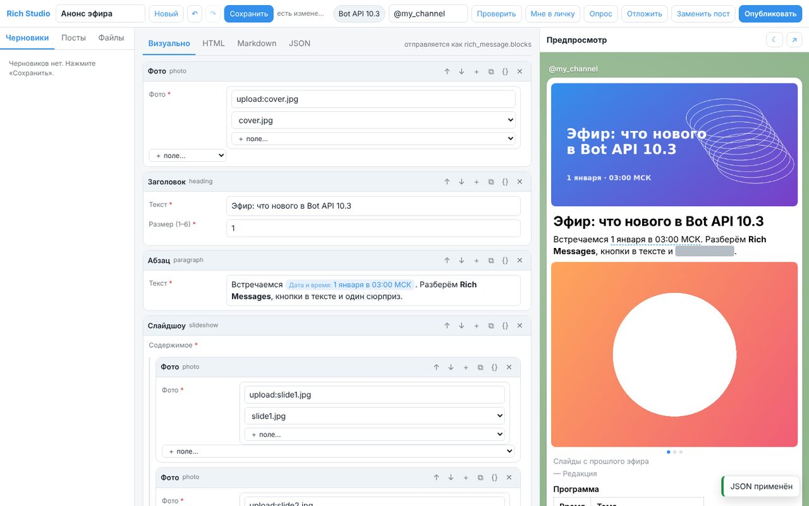

Скриншоты и ответы в примерах сняты со студии на подставном Telegram (`tests/mock_telegram.py`). Возможности только для каналов (первый комментарий в обсуждении, `members_only` у опроса, закреп в канале) на настоящем канале не проверялись, поэтому первую публикацию сделайте в тестовый канал.

**Содержание:** [что умеет](#что-умеет) · [быстрый старт](#быстрый-старт) · [версии Bot API](#новые-версии-bot-api) · [редактор](#редактор) · [предпросмотр](#предпросмотр) · [публикация](#публикация-и-работа-с-каналом) · [если пост мог уйти](#если-пост-мог-уйти) · [HTTP API](#http-api) · [MCP](#mcp-для-claude-и-других-агентов) · [skill](#skill-для-claude-code) · [настройки](#настройки) · [бэкап](#бэкап) · [журнал](#журнал-и-состояние) · [безопасность](#безопасность) · [разработка](#разработка)

## Что умеет

| Область | Возможности |
|---|---|
| Редактор | все блоки Bot API, режимы «Визуально», HTML, Markdown и JSON, черновики с автосохранением, шаблоны постов с полями, отмена правок, черновик из поста, пересланного боту |
| Предпросмотр | вид Telegram в светлой и тёмной теме, сверка с тем, как пост разобрал настоящий Telegram, отдельная страница для ссылки |
| Публикация | сразу, по расписанию, «мне в личку», в несколько каналов, замена текста или только кнопок с историей версий, удаление; опросы, Live Photo и платный контент отдельными сообщениями |
| Канал | закреп, первый комментарий, ответы на кнопки (и rich-ответ, который видит только нажавший), счётчики реакций и нажатий, пригласительные ссылки со счётчиком вступлений, предложенные посты |
| Свежесть | редактор строится из машиночитаемой спецификации Bot API, новые поля работают в день релиза |
| Агенты | HTTP API, MCP-сервер на `/mcp` с предпросмотром прямо в чате, `dry_run`, `Idempotency-Key`, отметка о том, кто отправил пост |

## Быстрый старт

Нужен Docker (Docker Desktop на Mac/Windows).

```bash
cd rich-studio
cp .env.example .env        # впишите TG_BOT_TOKEN, TG_DEFAULT_CHAT, TG_PREVIEW_CHAT
mkdir -p data               # данные студии; папка ваша, не root
docker compose up -d --build
```

Откройте http://localhost:7424, документация API — http://localhost:7424/docs (работает и без интернета). Обновление — та же `docker compose up -d --build`.

- **Бот:** токен от [@BotFather](https://t.me/BotFather). В канале сделайте бота админом с правом «Публикация сообщений», для правки ещё «Редактирование сообщений». Кнопка канала в шапке открывает окно «Каналы», где «Проверить» покажет, всё ли в порядке.
- **«Мне в личку»:** в `TG_PREVIEW_CHAT` ваш числовой id ([@userinfobot](https://t.me/userinfobot)); один раз напишите своему боту `/start`. От этого же аккаунта бот принимает пересланные посты в черновики.
- **Порт.** Студия слушает только `127.0.0.1:7424`. Другой порт: левое число в `ports` в `docker-compose.yml` и `STUDIO_URL` в `.env` и в окружении shell (оттуда адрес берут `.mcp.json` и хук здоровья). Открываете студию в сеть — выдайте токены или задайте ключ ([безопасность](#безопасность)).
- **Данные** лежат в `./data`: черновики, посты, файлы, кэш спецификации. Контейнер работает от пользователя `STUDIO_UID`/`STUDIO_GID` из `.env` (по умолчанию 1000:1000; на Linux с другим uid впишите `id -u` и `id -g`). Если `./data` создал Docker от root, студия скажет об этом при запуске; исправить: `sudo chown -R $(id -u):$(id -g) data`. На Docker Desktop это не нужно.
- **На своём сервере** с HTTPS, копией базы в S3 и готовым образом из GHCR: [deploy/README.md](deploy/README.md).

Без Docker: `pip install -r requirements.txt`, затем `cd app && DATA_DIR=../data uvicorn main:app --port 7424` (переменные из `.env` экспортируйте сами).

**Без бота и токена:** `make mock` и `make dev` в двух терминалах (студия на 7424 должна быть остановлена). Студия откроется на http://localhost:7424 и будет «публиковать» в подставной Telegram, а `POST http://localhost:8081/push` подаёт в него события: нажатия, реакции, голоса.

## Новые версии Bot API

1. **Пост уходит в Telegram как есть.** Студия не переводит его в свои классы, поэтому новый тег, блок или поле работает в день релиза, даже если студия о нём не знает: вкладки HTML и JSON, кнопка `{}` у блока, метод `/api/raw/<метод>`.
2. **Редактор строится из спецификации** ([telegram-bot-api-spec](https://github.com/PaulSonOfLars/telegram-bot-api-spec), пересобирается с core.telegram.org при каждом релизе): палитра блоков, формы полей, списки значений, элементы текста и проверка. Студия проверяет её при запуске и каждые 12 часов (`SPEC_REFRESH_HOURS`), а ↻ рядом с версией в шапке (или `POST /api/spec/refresh`, инструмент MCP `refresh_bot_api`) — сразу. Новые блоки появляются в палитре сами, бейдж версии подсвечивает, что изменилось.
3. **Без интернета** работает встроенная копия, `app/bundled/api.json`. Её обновляет `make spec-update`, обновление приходит отдельным PR; что дописать руками — в [«Что обновляется вручную»](#что-обновляется-вручную).
4. **На сервере** (`STUDIO_MODE=server`) спецификация закреплена (`SPEC_PIN`): студия ничего не скачивает, новая версия приходит с обновлением образа.

HTML-виджеты (`sendWidget`) в каналы не отправляются, поэтому в редакторе их нет ([0024](docs/decisions/0024-no-widgets-in-editor.md)); их методы, как и любые другие, доступны через `/api/raw`.

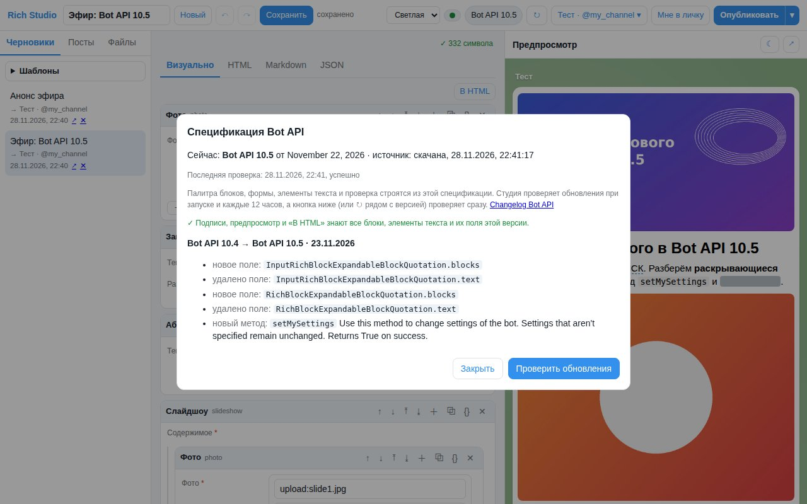

### Что обновляется вручную

- **Подписи и отрисовка.** Русские подписи блоков и элементов текста (`labels.js`; без них видно имя из спецификации), заготовки HTML-тегов (`snippets.js`), отрисовка новых блоков в предпросмотре (`render.js`; до неё блок показан рамкой с JSON) и таблица «блок → HTML» для кнопки «В HTML» (`html-export.js`; до неё кнопка отказывается переводить пост с новым блоком). Чего не хватает, показывает окно спецификации (`gaps` в `GET /api/spec`) и проверяет `tests/test_spec_coverage.py`.
- **Взятое из документации Bot API и замеров на настоящем Telegram** (Bot API 10.4), а не из спецификации; после новой версии это стоит сверить и перемерить. Лимиты rich-сообщения и как Telegram их считает, обрезка длинного текста, сущности HTML, символы, с которыми Telegram выбрасывает ссылку или отклоняет кнопку, необязательные `align` и `valign` у ячейки, отказы по типу чата: `app/spec/validator.py` (подсказки и названия чатов к ним — `app/spec/chats.py`). Правила разбора HTML и Markdown: `render.js` и примеры в `tests/telegram_parse/`, их переснимает `scripts/capture_telegram_parse.py` (как запускать — в его начале). Окно в 15 секунд и запрещённые поля rich-ответа: `app/services/callbacks.py`, флажок «Показать вместо поста» — `reply-dialog.js` и `keyboard.js`. Какие entity Telegram находит в тексте сам и как поля пересланного поста называются в rich-посте: `app/spec/entities.py`, `app/services/forward_import.py`.
- **Зависимости.** Python-пакеты: поднимите пин в `requirements.txt` или `requirements-dev.txt` (что устарело, покажет `.venv/bin/pip list --outdated`) и выполните `make lock`; зависимости зависимостей поднимает `make lock LOCK_ARGS=--upgrade`. CodeMirror для вкладок исходника: `make vendor-update`. Dependabot их не трогает ([0020](docs/decisions/0020-dependabot-self-contained-prs.md)). Swagger UI для `/docs`: по заметке `app/static/vendor/swagger-ui/README.md`.

## Редактор

| Вкладка | Что это |
|---|---|
| **Визуально** | Конструктор из блоков (`rich_message.blocks`): заголовки, таблицы, списки и чек-листы, цитаты, раскрывашки, коллажи, слайдшоу, карты, кнопки, медиа. У текстового поля в фокусе появляется панель форматирования; «＋ элемент…» в ней вставляет дату-время, кастомные эмодзи, формулы, сноски, якоря, кнопки в тексте и всё остальное из спецификации. |
| **HTML** | Rich HTML с панелью заготовок; заготовки, чей синтаксис взят из сторонних источников, помечены (⚠ в подсказке). |
| **Markdown** | Rich Markdown (GFM и разрешённые теги). |
| **JSON** | Весь запрос: `rich_message`, `reply_markup`, `options`. Пост меняется только по «Применить JSON»; неприменённый текст хранится в черновике, у вкладки горит точка. |

У каждого режима свой текст; отправляется тот, что открыт (JSON — после «Применить JSON»). Вкладки HTML, Markdown и JSON — редактор кода: подсветка, поиск и замена (Ctrl+F), подсказки по ходу набора или по Ctrl+Пробел (теги и атрибуты из заготовок, поля Bot API из спецификации). Галочка «Простой редактор» под полем возвращает обычное поле ввода, если на телефоне сбоит клавиатура.

Кнопка «В HTML» над блоками переводит визуальный пост в HTML-исходник во вкладке HTML: его удобно править руками или отдать агенту. Свой текст во вкладке HTML студия заменит только после вопроса (вернуть его можно отменой ↶). Если поле или блок в HTML не попадёт или Telegram прочитает его иначе, окно перечислит, что мешает, а вкладка HTML не изменится.

Кнопка «＋ блок» открывает палитру по группам с поиском; новые блоки из спецификации попадают в «Другое»:


Элементы внутри текста редактируются в окне, построенном по спецификации; дату предпросмотр сразу показывает так, как её увидит подписчик:

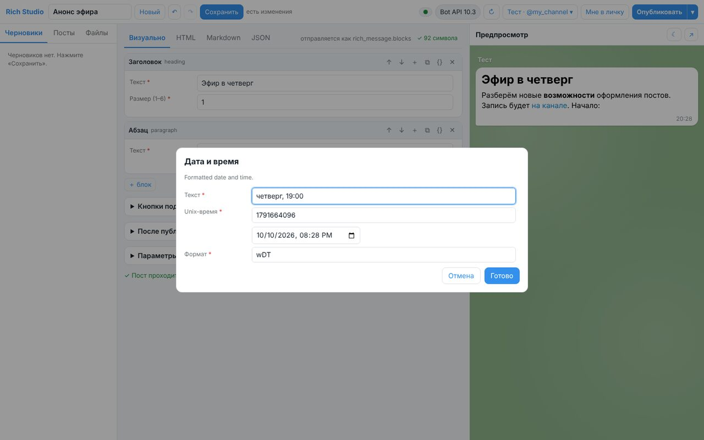

**Набор текста.**
- Вставка из Google Docs, Notion или браузера сохраняет жирный, курсив, подчёркивание, зачёркивание, код, индексы и ссылки; остальная разметка отбрасывается.
- Картинка из буфера или перетащенная на блок становится блоком «Фото» после него (видео и аудио — своими блоками).
- Ctrl+K (или 🔗) ставит или правит ссылку. Адрес без сайта (`https://`) окно не примет, как и Telegram.
- Таблица — сетка полей; заголовок, выравнивание и объединение ячеек настраиваются в панели под ней. Таблица из Google Sheets или Excel вставляется в любую ячейку и растягивает сетку.
- Блок переносят ↑↓ или сразу в начало и конец (⤒ ⤓). ↶ ↷ (Ctrl+Z и Ctrl+Shift+Z вне текстовых полей) отменяют и возвращают правки всего поста.

| Ctrl+K: адрес без сайта окно не примет | Таблица: сетка и панель ячейки, три строки вставлены из таблицы |
|---|---|
| 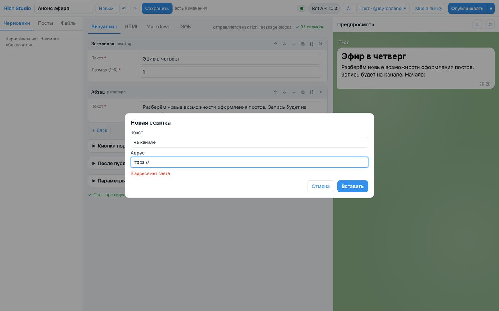 |  |

Проверка по спецификации видна внизу редактора, её итог и счётчик символов — рядом со вкладками. Замечание называет блок словами («Раскрывашка №3 › Заголовок: пустой текст») и по нажатию подсвечивает поле:

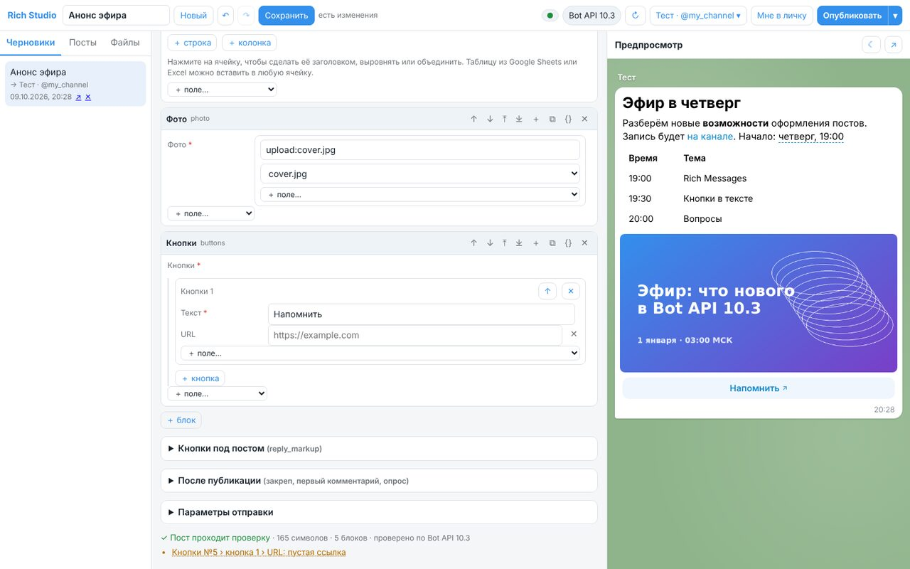

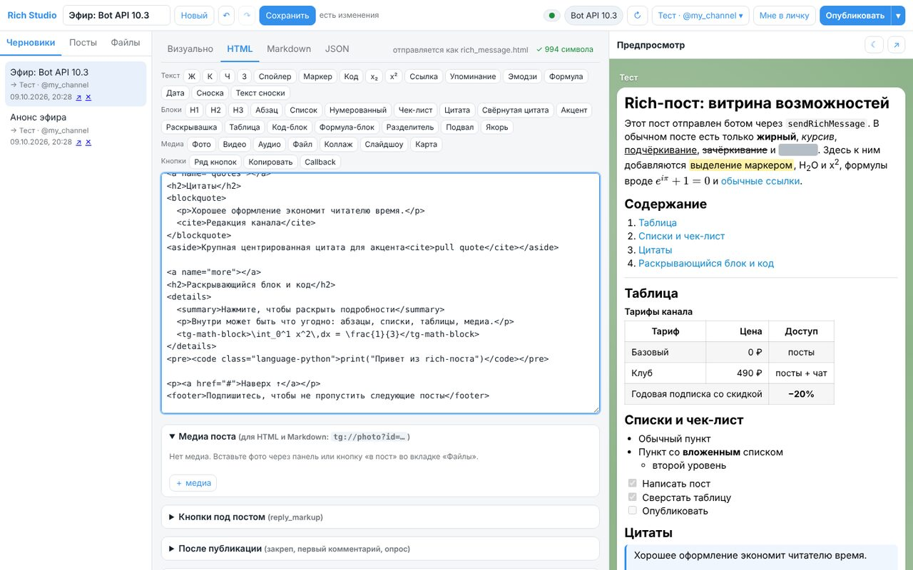

Тот же пост после трёх отмен: убраны кнопка, фото и вставленные строки таблицы.

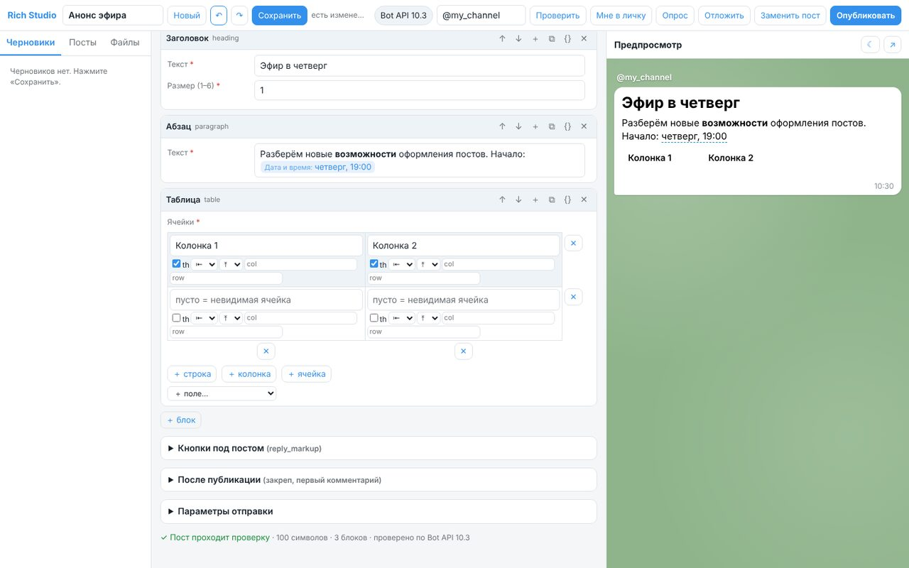

Ниже блоков: медиа поста для HTML и Markdown (ссылки `tg://photo`, `tg://video`, `tg://audio`, `tg://document`), кнопки под постом, панель «После публикации» (закреп, первый комментарий, опрос) и параметры отправки (без звука, защита от пересылки и любые другие параметры `sendRichMessage`). Слева: черновики, посты (опубликованные и отложенные) и файлы (загрузка перетаскиванием, кнопка «в пост»). Тема студии выбирается в шапке (до выбора следует теме системы), тему предпросмотра переключает ☾ над ним.

Черновик сохраняется сам через пару секунд после правки. Если тот же черновик сохранили в другой вкладке или агентом, редактор не перезапишет его молча, а спросит, чью версию оставить. Поля, которых форма не показывает, редактор хранит и отправляет как есть, а правятся они во вкладке JSON. О поле верхнего уровня, которого у поста нет (например, от агента), предупреждает проверка внизу: в Telegram оно не уйдёт. Если поле, которое форма показывает, задано в виде, который она не читает (`"pin": "yes"`), над редактором есть замечание: оно уйдёт как есть, а форма его не меняет.

**Шаблоны постов.** Рубрику (дайджест, анонс) не нужно собирать каждый раз заново. «Шаблоны» над черновиками → «＋ Текущий пост шаблоном»: окно показывает строки поста, и «→ поле» делает строку полем `{{ключ}}` со значением по умолчанию; в HTML `{{имя}}` можно вписать прямо в текст. Поле бывает строкой, несколькими строками или ссылкой (или файлом `upload:имя`) и может быть обязательным. «Новый пост» у шаблона открывает форму из его полей и создаёт черновик без каналов. Значение всегда встаёт текстом (в HTML экранируется), поэтому разметки не создаст. Где поле стоять не может (внутри тега, кусок адреса, Markdown, `callback_data` кнопки с ответом), сохранение откажет с причиной. Файл, нужный шаблону, уборка не удалит.

На телефоне редактор и предпросмотр — две вкладки:

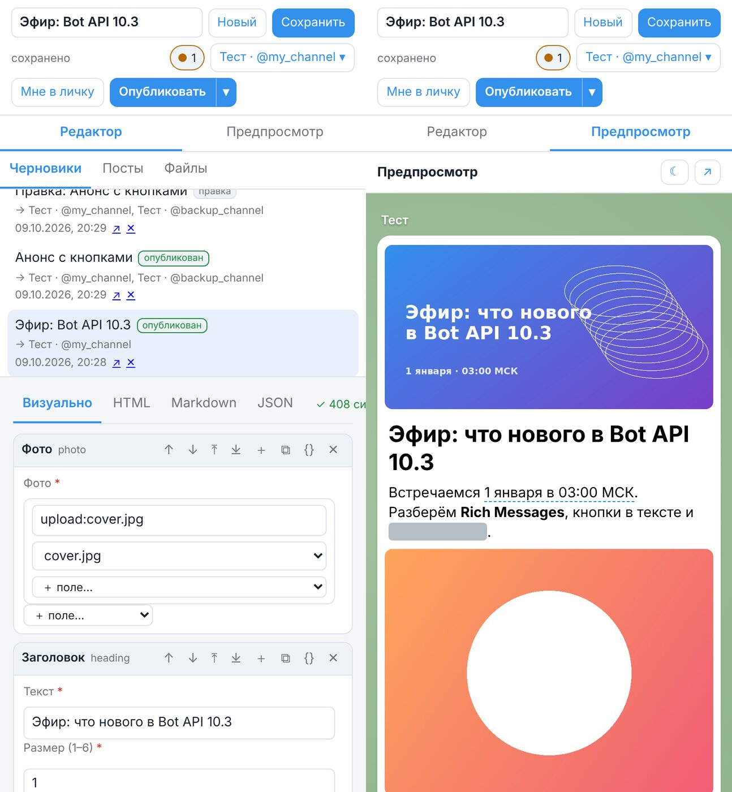

## Предпросмотр

Предпросмотр справа повторяет Telegram в светлой и тёмной теме: таблицы, формулы (KaTeX), спойлеры, свёрнутые цитаты, слайдшоу, карта (OpenStreetMap), кнопки. Код-блок, как в Telegram Desktop, без подсветки синтаксиса ([почему](docs/decisions/0022-code-block-without-highlighting.md)). Формулу глубже 64 уровней вложенности предпросмотр не рисует, а показывает исходник красным: формулы около 130 уровней роняют вкладку браузера. Кнопка ↗ открывает пост отдельной страницей.

HTML и Markdown предпросмотр разбирает по правилам настоящего Telegram: примеры вместе с блоками, которые вернул Telegram, лежат в `tests/telegram_parse/captured.json`, и `npm run test:parity` сверяет с ними предпросмотр.

После «Мне в личку» над предпросмотром появляется сверка: Telegram возвращает блоки, на которые разобрал пост, и студия показывает «✓ так же» или «≠ иначе» с местом расхождения. «Как разобрал Telegram» показывает пост из его блоков, а «В визуальный» переносит HTML или Markdown в визуальный режим так, как его понял Telegram.


Примеры из папки `examples/`, отрисованные `npm run test:shots`:

| `post-showcase.html`, светлая тема | `post-blocks.json`, тёмная тема |
|---|---|
|  | 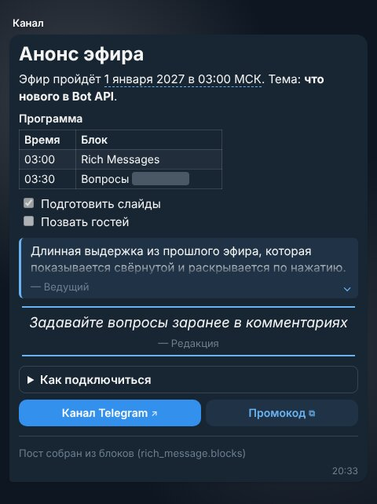 |
| **`post-media.html`, светлая тема** | **`post-extras.html`, тёмная тема** |
| 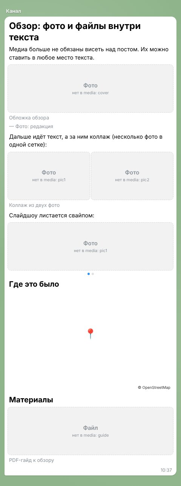 |  |

Анонс со слайдшоу, картой и кнопками в тёмной теме редактора:

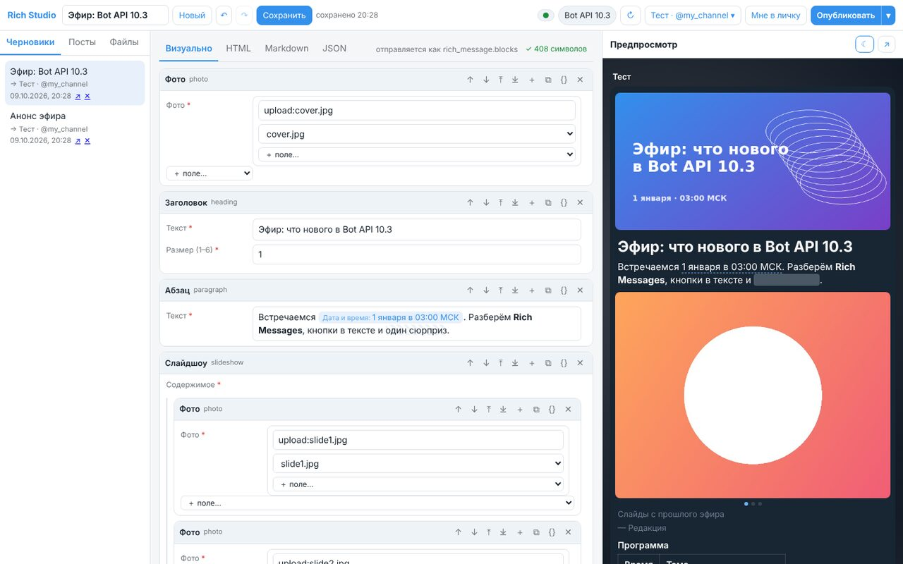

## Публикация и работа с каналом

### Каналы

Канал хранится в черновике: черновик для канала A уйдёт в A, а не туда, куда публиковали последним. Новый черновик начинается с канала по умолчанию (`TG_DEFAULT_CHAT`). Кнопка с названием канала в шапке открывает окно «Каналы»: выбрать канал («Сюда»), добавить новый и проверить его. В поле «Куда публиковать» можно вписать несколько каналов через запятую (`@one, @two`), и пост уйдёт в каждый: если один не принял, остальные всё равно получат, а ошибка покажется отдельно; отложка тоже создаётся для каждого. Проверенный канал везде подписан «название · id».

«Проверить» спрашивает у Telegram, админ ли бот в канале и какие у него права:


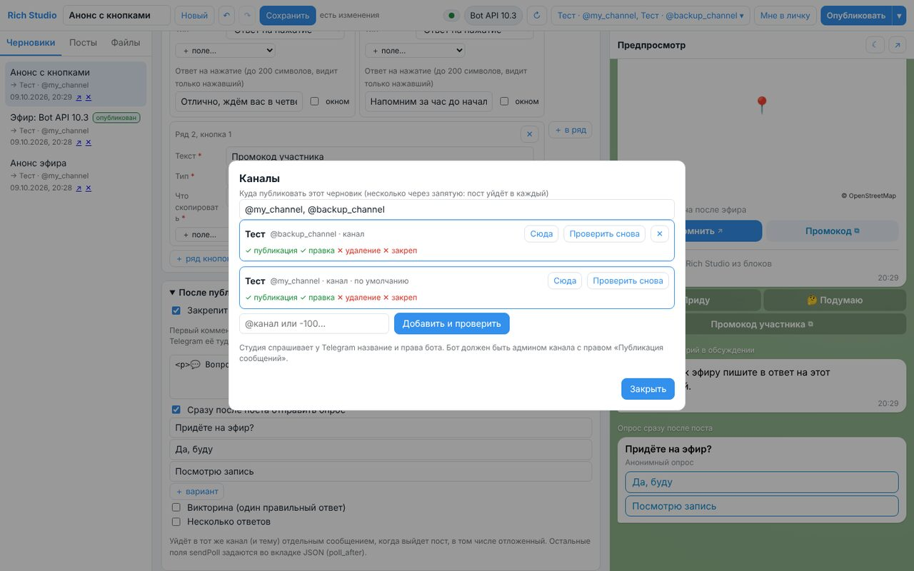

**Темы форума.** Для форума с известными темами в «Параметрах отправки» появляется «Тема форума» (`message_thread_id`). Bot API не умеет перечислять темы, поэтому новые студия запоминает сама, когда видит их создание, а существующие добавляются в окне «Каналы» по номеру из ссылки. Тема задаётся для одного канала-форума: с несколькими каналами пост с темой не уйдёт. Тема принадлежит своему форуму: в другом канале она снимается, и ни отмена, ни «Применить» в JSON её туда не перенесут. У поста на правке это форум самого поста, а копия не вышедшего поста («Открыть» в «Постах») открывается в его форуме с темой.

### Публикация и отложка

«Опубликовать» отправляет пост сразу; в меню «▾» рядом с ней «Отложить…», «Опрос…», «Live Photo, платное…» и «Заменить пост…». «Мне в личку» отправляет пост вам. Опубликованный пост появляется во вкладке «Посты» с `message_id` и ссылкой:


В окне «Отложить» есть быстрые варианты («Через час», «Завтра в 9:00»…), часовой пояс браузера и очередь на неделю.


Отложенные посты отправляет сама студия, поэтому в момент публикации она должна работать. Пост, опоздавший больше чем на `SCHEDULE_LATE_MIN` минут (60), не уходит, а становится «пропущен»: утренний анонс, ушедший вечером, хуже, чем никакой. Откройте его и опубликуйте или отложите заново. Если Telegram недоступен (нет сети после сна ноутбука), студия повторяет попытку раз в минуту, пока не выйдет этот срок.

Студия работает одним процессом: один контейнер, без `--workers`. Второй процесс, запущенный по ошибке, не отправляет отложенные посты и не принимает события, пока работает первый, и `/api/health` предупреждает об этом в проверке `loops`. При остановке студия до 10 секунд ждёт открытые запросы и даёт начатым отправкам до 30 секунд. После аварийного перезапуска отложенные посты пойдут через минуту.

### Кнопки и ответы на нажатия

Тип кнопки под постом выбирается списком: «Ссылка», «Ответ на нажатие», «Скопировать текст» или «Другое…» (любые поля `InlineKeyboardButton`). Для ответа на нажатие студия сама придумывает `callback_data`, вы пишете только текст всплывающей подсказки или окна. Если действие кнопки не работает в выбранных каналах (например, `web_app` в канале: Mini App открывается только из лички), на карточке кнопки есть пометка с подсказкой: кнопка-ссылка на прямую ссылку Mini App `https://t.me/<бот>/<приложение>?startapp=…` работает и из канала.

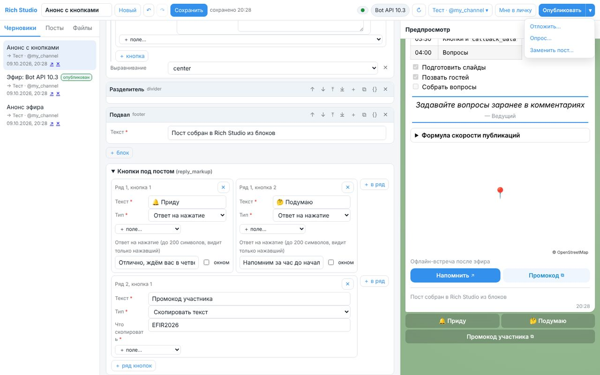

Студия отвечает на каждое нажатие, даже без заданного текста, иначе кнопка у читателя «крутится», и считает нажатия по кнопкам. Ответы на кнопки в тексте поста (`<tg-button>`, блок «Кнопки») задаются во вкладке JSON, в `callbacks`.

**Rich-ответ.** «Rich-ответ…» в карточке кнопки задаёт целое rich-сообщение, которое увидит только нажавший. Под постом канала оно приходит отдельным сообщением от бота с пометкой «Видите только Вы», а с флажком «Показать вместо поста» встаёт на место поста только у нажавшего, без кнопок поста и до перезапуска Telegram. Telegram принимает ответ 15 секунд после нажатия и не обещает доставку. Студия ждёт его до 4 секунд, затем отвечает на нажатие и ответ не повторяет; недошедший виден во вкладке «Посты» («rich-ответ не дошёл») и в журнале (`callback.reply_failed`). Устройство: [0021](docs/decisions/0021-ephemeral-callback-reply.md).

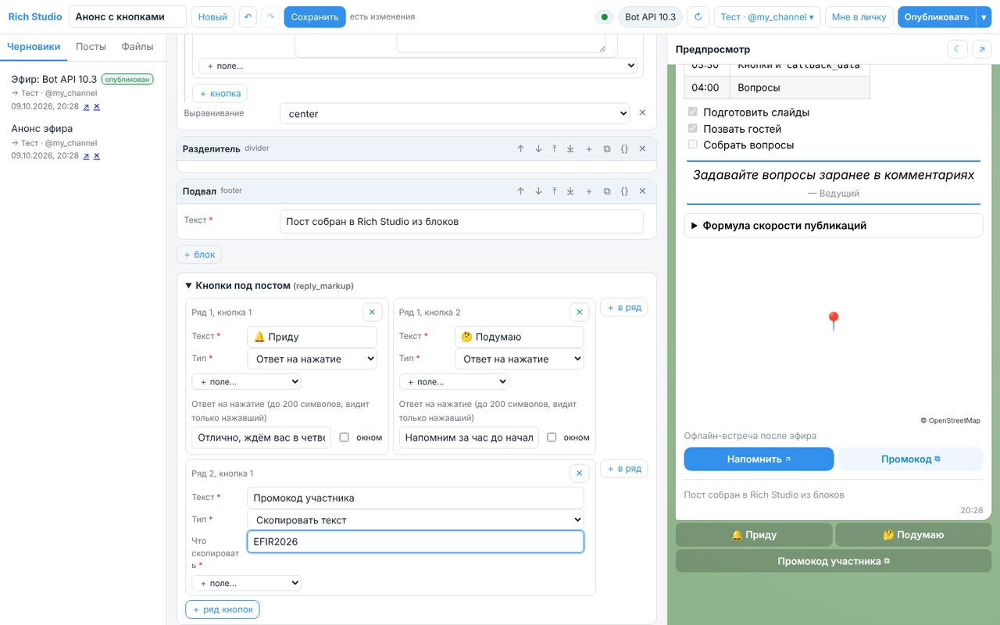

### Закреп, первый комментарий, опрос

Закреп и первый комментарий задаются в панели «После публикации». Закреп ставится без уведомления подписчиков; боту нужно право «Редактирование сообщений» (или «Закрепление»). Первый комментарий студия отправляет ответом на пост, когда Telegram перешлёт его в группу обсуждения: бот должен быть **админом группы обсуждения**, иначе он не видит пересылку. При `TG_UPDATES=off` студия пересылку не увидит и сразу предупредит; если пересылка не пришла за сутки, комментарий помечается ошибкой. Статус комментария виден во вкладке «Посты», а в «Мне в личку» комментарий приходит ответом на пост.

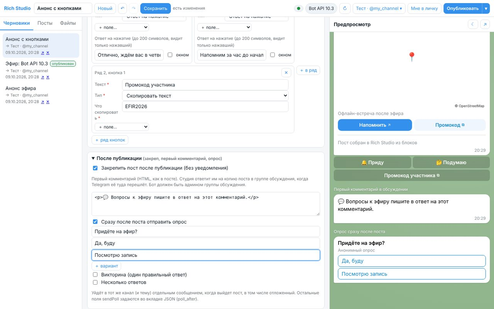

**Опросы:** «Опрос…» в меню «Опубликовать ▾». Викторина с пояснением, несколько ответов, «только подписчики старше суток» (`members_only`), страны, описание, автозакрытие, скрытые до закрытия результаты, закреп, отложка; остальные параметры `sendPoll` дописываются JSON-ом. «После поста» прикрепляет опрос к черновику (или составьте его в панели «После публикации»): он уходит в тот же чат и тему сразу после поста, отложенного тоже. Если Telegram опрос не принял, пост остаётся опубликованным, а опрос появляется в «Постах» с ошибкой.


### Live Photo и платный контент

«Live Photo, платное…» в меню «Опубликовать ▾». В rich-посте таких блоков нет, поэтому это отдельное сообщение, как опрос. Live Photo (`sendLivePhoto`) — короткое видео и кадр из него, оба файла из вкладки «Файлы». Платный контент (`sendPaidMedia`) — до 10 фото, видео и Live Photo под размытием за звёзды; в канале должна быть разрешена публикация платного контента. Оба можно отложить, закрепить и подписать, а заменить нельзя, только удалить.

### Посты и их правка

Во вкладке «Посты» видны состояние приёма событий, закреп, реакции, нажатия кнопок, статус первого комментария и итоги опросов («Закрыть опрос»). У поста кнопки «Править», «Закрепить / Открепить» и «Удалить». Просмотров и охватов Bot API не отдаёт.

«Править» открывает пост черновиком-копией с плашкой «Правите пост #N в @канал»: «Обновить пост» в ней заменяет этот пост (`editMessageText`), а «Опубликовать» в шапке предупредит, что выйдет новый пост. «Кнопки» у открытого на правку поста заменяет только кнопки под ним и их ответы на кнопки из редактора; текст и ответы кнопок в тексте не меняются. Отложенный и пропущенный пост обновляются так же; отложенный можно «Перенести», пропущенный — «Отложить заново» или отменить. Если пост тем временем изменили (агент, другая вкладка), «Обновить пост» скажет об этом и заменит его только после подтверждения. «История» показывает, как пост выглядел до каждой замены, со строками, которые версия убрала и добавила, и мини-предпросмотром; любую версию можно загрузить в редактор и вернуть в канал.

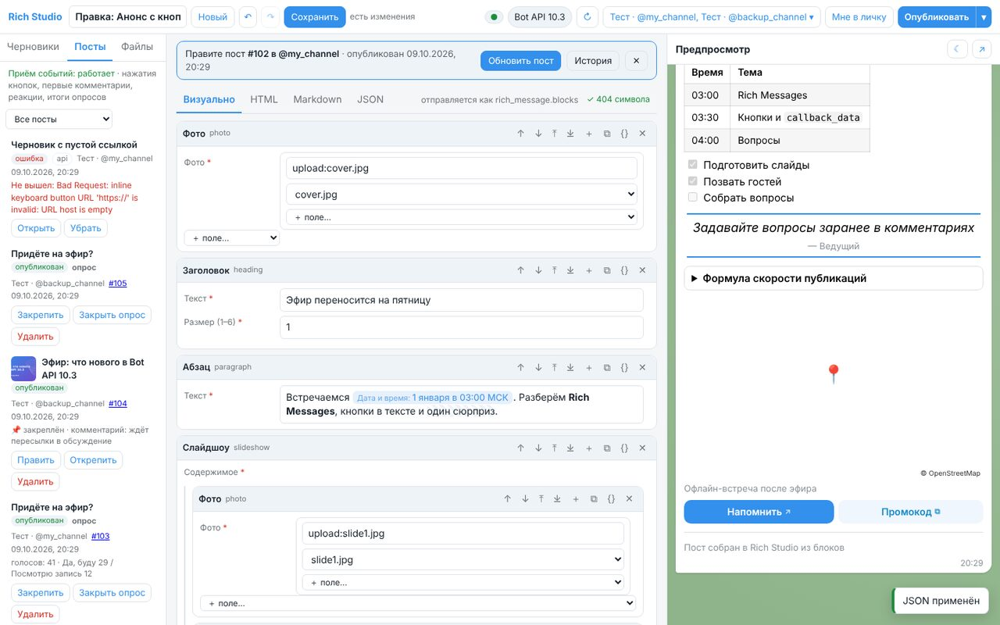


### Пост из Telegram в черновик

Перешлите боту пост (свой или чужой) в личном чате с аккаунта из `TG_PREVIEW_CHAT`: он станет черновиком с тем же оформлением, а бот поставит на ваше сообщение реакцию ✍. Медиа не скачиваются: черновик ссылается на файлы, которые уже лежат в Telegram, поэтому в предпросмотре вместо них заглушка «Фото из Telegram» (видео, GIF, файл), а в канал и в «Мне в личку» они уходят вместе с постом. Что перенести не удалось (кнопки, которые работают только у бота исходного поста; стикер, опрос, платное медиа), записано в замечаниях над редактором. Канал у такого черновика не задан: без выбора публикация, как у любого нового черновика, уйдёт в канал по умолчанию. Если черновик сделать нельзя (например, содержимое защищено от копирования), бот коротко ответит почему; чужие сообщения он молча пропускает. Нужен приём событий. Устройство: [0015](docs/decisions/0015-forward-import.md).

### Пригласительные ссылки

«Ссылки» у проверенного канала в окне «Каналы». Сделайте отдельную ссылку на каждую площадку, где рассказываете о канале, и студия покажет, сколько человек вступило по каждой. Ссылка бывает обычной (со сроком и пределом вступлений), по заявке и платной подпиской за звёзды на 30 дней (только в канале). Telegram таких счётчиков боту не даёт: студия считает вступления и заявки сама по событиям, поэтому нужен приём событий, а ушедших она не вычитает. Боту нужно право «Пригласительные ссылки».

### Предложенные посты

Если в канале включены личные сообщения, подписчики могут предлагать посты, бесплатно или за звёзды. Студия собирает их над списком во вкладке «Посты»: «Опубликовать сейчас» или «В выбранное время» принимает пост (Telegram публикует его сам и списывает с автора цену), «Отклонить» отказывает с комментарием автору. Решение уходит в Telegram один раз: если Telegram не ответил, предложение ждёт итога и повторно не отправляется. Если итог не пришёл, проверьте личные сообщения канала и нажмите в окне предложения «Решить снова»; это может только человек (в MCP этого нет, маршруту нужен уровень `admin`). Нужны приём событий и бот-админ канала с правами «Личные сообщения канала» и «Публикация сообщений».

### События от Telegram

Нажатия, комментарии, реакции, итоги опросов, вступления, предложенные посты и пересланные боту посты студия получает сама через `getUpdates`. Если этот же бот уже работает где-то ещё (вебхук или другой процесс с `getUpdates`), будет конфликт: заведите для студии отдельного бота или выключите приём (`TG_UPDATES=off`), тогда публикация работает, а кнопки, комментарии и счётчики нет. События за время, пока студия выключена дольше суток, теряются.

## Если пост мог уйти

Студия не публикует пост второй раз наугад. Обрыв сети, ответ 5xx или остановка посреди отправки значат «пост мог уйти»: повтора нет ни у планировщика, ни по `Idempotency-Key`. Повторяется только то, что точно не дошло до Telegram: нет соединения или 429. Подробно: [политика ошибок](docs/ARCHITECTURE.md#политика-ошибок-при-отправке).

- **Пост или опрос.** Запись «Исход неизвестен» во вкладке «Посты» остаётся и после успешной отправки того же черновика, а `/api/health` показывает её, пока вы не проверите канал и не нажмёте «Убрать» (это убирает только запись).
- **Первый комментарий.** Пост в канале, у него «комментарий: ошибка» с «мог уйти», и `/api/health` показывает это сутки. Посмотрите обсуждение и, если комментария нет, опубликуйте его вручную в Telegram. «Убрать» у такого поста нет, а «Удалить» удалит из канала сам пост.
- **Пост ушёл, а студия не смогла его записать** (диск полон, база только для чтения): ответ 502 «опубликован, студия не смогла записать — не публикуйте повторно» с `chat_id` и `message_id`. Пост в канале; освободите место, и студия допишет запись сама. Закреп, комментарий и опрос после такого поста не делаются. Если студию перезапустили раньше, пост станет «Исход неизвестен».

## HTTP API

Все маршруты с описаниями: [docs/reference/http-api.md](docs/reference/http-api.md) (собирается из кода командой `make docs`), интерактивно с примерами — `/docs` работающей студии (Swagger UI без CDN). В защищённой студии `/docs` и `/openapi.json` открываются после входа в редактор; «Authorize» на странице принимает токен, чтобы попробовать запрос от его имени. Без ключа и вне схемы: `GET /healthz` (жив ли процесс) и `GET /readyz` (готова ли студия: 503 и имена сбойных проверок). Контракт API: `docs/openapi.json`.

Пост везде один: `{"rich_message": {...}, "reply_markup": {...}, "options": {...}, "pin": true, "comment": {"html": "..."}, "callbacks": {"like": "Спасибо!"}, "poll_after": {...}}`. `pin`, `comment`, `callbacks` и `poll_after` студия обрабатывает сама и в Telegram не отправляет. Другие параметры `sendRichMessage` кладите в `options`: незнакомое поле верхнего уровня остаётся в посте, но в Telegram не уходит, и проверка о нём предупреждает. Каналы задаются рядом с `post` (`chat_id`, `chat_ids`), внутри поста это ошибка. Без них публикация по `draft_id` уходит в каналы черновика (черновика нет — 400), иначе в канал по умолчанию. Файлы из загрузок — `upload:<имя>`. Время в `/api/schedule` — unix или ISO 8601 с часовым поясом (`2026-10-10T09:00:00+03:00`). Как писать сам пост (теги, лимиты, ответы на кнопки) — в [skill](.claude/skills/telegram-rich-posts/SKILL.md).

### Примеры

Ответы получены на подставном Telegram (`make mock` + `make dev`), длинные поля сокращены.

**Проверка поста.** `/api/validate` проверяет пост по спецификации, кнопки, первый комментарий, rich-ответы на кнопки и [лимиты rich-сообщения](https://core.telegram.org/bots/api#rich-message-limits) так, как их считает настоящий Telegram (`app/spec/validator.py`). Для проверенных каналов она ещё предупреждает, что Telegram в чате такого типа не примет (например, кнопку `web_app` в канале): правила взяты из описаний спецификации ([0023](docs/decisions/0023-chat-type-rules-from-descriptions.md)) и из замера. Число вне диапазона из описания поля (размер заголовка 1–6, масштаб карты 0–24) — тоже предупреждение, а поле редактора обводит такое число красным. Ошибка в названии поля таблицы находится до отправки:

```bash
curl -s localhost:7424/api/validate -H 'content-type: application/json' \
  -d '{"rich_message": {"blocks": [{"type": "table", "rows": []}]}}'
```
```json
{"ok": false,
 "errors": ["rich_message.blocks[0]: нет обязательного поля cells (InputRichBlockTable)"],
 "warnings": ["rich_message.blocks[0].rows: поля нет в InputRichBlockTable (спецификация Bot API 10.5)"],
 "stats": {"blocks": 1, "depth": 1, "chars": 0, "max_string_bytes": 0, "media": 0}, "spec_version": "Bot API 10.5"}
```

**Пробная отправка.** `"dry_run": true` показывает запросы, которые уйдут в Telegram, ничего не отправляя и не записывая:

```bash
curl -s localhost:7424/api/send -H 'content-type: application/json' -d '{
  "post": {"rich_message": {"blocks": [
    {"type": "heading", "size": 1, "text": "Анонс эфира"},
    {"type": "paragraph", "text": ["Начало в ", {"type": "bold", "text": "19:00"}]}]}},
  "chat_id": "@my_channel", "dry_run": true}'
```
```json
{"dry_run": true,
 "requests": [{"method": "sendRichMessage",
               "params": {"chat_id": "@my_channel", "rich_message": {"blocks": ["…те же блоки…"]}}}],
 "after_send": [], "warnings": []}
```

**Публикация без дублей.** Тот же запрос без `dry_run`, с ключом повтора и подписью отправителя. Повтор с тем же ключом (например, после таймаута) вернул тот же `message_id` 101, а подставной Telegram получил ровно один `sendRichMessage`:

```bash
curl -s localhost:7424/api/send -H 'content-type: application/json' \
  -H 'Idempotency-Key: anons-0910' -H 'X-Studio-Client: script:cron' -d '{"post": {…}, "chat_id": "@my_channel"}'
```
```json
{"post": {"id": "cb5e7c0de590", "chat_id": "@my_channel", "message_id": 101,
          "status": "sent", "actor": "script:cron", "…": "…"}}
```

Заголовки и поля `/api/send`, `/api/schedule` и `/api/poll`:
- `Idempotency-Key`: повтор с тем же ключом возвращает первый результат, а не публикует пост второй раз. Рассылка, ушедшая не во все каналы, — ответ 200 с `results[].ok` и причиной по каждому каналу; повтор с тем же ключом вернёт его же и ничего не отправит. Дошлите пост только в каналы с `ok: false` и с новым ключом. После «пост мог уйти» повтор с тем же ключом отвечает той же ошибкой в любой срок: проверьте канал и только потом отправляйте с новым ключом. Ключ завершённого запроса живёт сутки.
- `X-Studio-Client` (например, `mcp:claude-code`) записывается в историю постов: во вкладке «Посты» видно, что пост отправил не редактор.
- `"dry_run": true` в теле `/api/send` и `/api/schedule`: проверка и список запросов без отправки и записи.
- Черновик-правку опубликованного поста (`draft_id` черновика с `post_id`) `/api/send` и `/api/schedule` не публикуют: ответ 409 с адресом `/api/posts/{id}/edit`. Копию выпускает только явный `"as_new": true`.

**Проверка канала:**

```bash
curl -s -X POST 'localhost:7424/api/check?chat_id=@my_channel'
```
```json
{"bot": {"id": 42, "username": "studio_test_bot"},
 "chat": {"id": -1001, "title": "Тест", "type": "channel", "username": null},
 "status": "administrator", "rights": {"can_post_messages": true, "can_edit_messages": true}, "can_post": true}
```

Проверка запоминает канал в списке «Каналы», поэтому это `POST` (уровень `draft`): `GET` в студии ничего не меняет.

## MCP для Claude и других агентов

Студия — MCP-сервер на `http://localhost:7424/mcp` (Streamable HTTP). Claude Code, открытый в папке студии, подключает его сам из `.mcp.json` (при первом запуске спросит разрешение). Адрес берётся из `STUDIO_URL`, токен агента — из `STUDIO_TOKEN`, ключ — из `STUDIO_API_KEY`: экспортируйте их в shell. `STUDIO_URL` пишите без `/` в конце, а для адреса по умолчанию снимите её (`unset STUDIO_URL`): пустое значение даёт пустой адрес. Из других папок подключение вручную:

```
claude mcp add --transport http rich-studio http://localhost:7424/mcp
# если студия защищена: именной токен агента (make token NAME=… LEVEL=…) или STUDIO_API_KEY
claude mcp add --transport http rich-studio http://localhost:7424/mcp --header "Authorization: Bearer <токен>"
```

Инструменты с описаниями: [docs/reference/mcp-tools.md](docs/reference/mcp-tools.md) (собирается из кода командой `make docs`). Агент сохраняет черновик (`save_draft` сразу отвечает проверкой), показывает предпросмотр прямо в чате и публикует по `draft_id` ровно ту версию, которую вы видели: если вы успели изменить черновик в редакторе, публикация откажет. Ответы дают `editor_url`, ссылку на черновик или пост в редакторе (адрес из `STUDIO_URL`); открытый черновик, который поменял агент, обновляется сам. Правка опубликованного поста уходит только через `edit_post`, вторым постом в канал она не попадёт. Если агент не передал ключ повтора, ключом считается сам запрос: повтор той же публикации в тот же канал в течение суток второй раз пост не опубликует. Пост по рубрике агент собирает из ваших шаблонов.

Как это выглядит в работе. Вызовы и ответы настоящие (студия на подставном Telegram), окно чата нарисовано для демонстрации. Агент проверяет пост, сам исправляет ошибку, на которую указала студия, и сохраняет черновик:

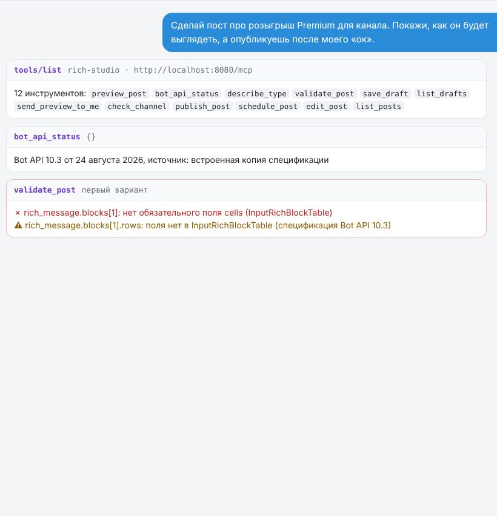

`preview_post` показывает пост в чате так, как его нарисует Telegram (MCP App `ui://rich-studio/preview`, тот же `render.js`), вместе с ошибками проверки. Это работает в клиентах с поддержкой MCP Apps, например в Claude; остальные получают тот же результат текстом. Картинки `upload:<имя>` в окне не загружаются: у него нет доступа к сети.


После вашего «ок» агент делает пробную отправку и публикует с ключом повтора; повтор не создаёт дубль, а в списке постов публикация записана с отметкой `mcp`:

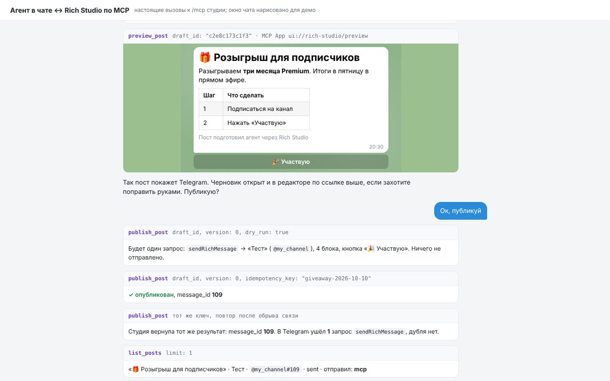

Публикация помечена как действие с внешним эффектом, и клиент обычно спрашивает подтверждение, но это решает клиент, а не студия: если вызов в нём разрешён заранее, агент опубликует без вопроса (в том числе по указке текста, который он прочитал). Чтобы агенты только готовили черновики, а публиковали вы из редактора, задайте `MCP_PUBLISH=off`: инструментов, которые публикуют или меняют канал, у агентов не будет. Удаление постов и произвольные методы Bot API (`/api/raw`) через MCP недоступны.

## Skill для Claude Code

`.claude/skills/telegram-rich-posts/SKILL.md` учит агента писать, проверять и публиковать посты: сначала сверяет версию Bot API, содержит шпаргалку по блокам, тегам, лимитам и ограничениям каналов и публикует только после вашего подтверждения. Claude Code, запущенный в папке студии, находит его сам (`/telegram-rich-posts` или просто попросите написать пост). Для других проектов скопируйте папку в `~/.claude/skills/`.

Агент, у которого есть только MCP студии (студия на сервере, Claude Code в другой папке, другие клиенты), получает этот же файл от самой студии: ресурс `skill://telegram-rich-posts/SKILL.md` (по соглашению MCP о skills, [SEP-2640](https://modelcontextprotocol.io/seps/2640-skills-extension)) и prompt `telegram-rich-posts`. Инструкции сервера говорят агенту прочитать его перед постом; в Claude Code его можно упомянуть как `@rich-studio:skill://telegram-rich-posts/SKILL.md` или вызвать `/rich-studio:telegram-rich-posts`. Доступ тот же, что к инструментам: в защищённой студии хватает уровня `read`.

## Настройки

Настройки с пояснениями и значениями по умолчанию лежат в `.env.example`, кроме `DATA_DIR` (папка данных; в контейнере это `/data`, то есть `./data`). `TG_API_BASE` — свой сервер Bot API, нужен только для файлов больше 50 МБ: с ним предел загрузки `MAX_UPLOAD_MB` по умолчанию 2000 МБ вместо 50. Неверные значения студия перечисляет при запуске разом и не стартует. Секреты можно передать файлами: `TG_BOT_TOKEN_FILE`, `STUDIO_API_KEY_FILE`.

`STUDIO_MODE=server` для студии в интернете ([deploy/README.md](deploy/README.md)): без токена или ключа, без `https://` в `STUDIO_URL` и без токена бота студия не стартует, а `STUDIO_API_KEY` там не короче 32 символов (`python -c 'import secrets;print(secrets.token_urlsafe(32))'`): неудачные попытки ключа не считаются, от перебора защищает только длина. Именные токены и так длинные.

## Бэкап

Всё, что хранит студия (черновики, посты, история правок, счётчики, загруженные файлы), лежит в `./data`. «Скачать бэкап» во вкладке «Файлы» (или `GET /api/export`) отдаёт zip: согласованную копию базы `studio.db`, снятую без остановки, и папку `media/`. Кроме того, раз в сутки студия кладёт копию базы в `./data/backups/` и хранит последние 7 (`BACKUP_KEEP`, 0 выключает). Эта копия спасает от случайного удаления, но не от потери диска: zip храните в другом месте.

Восстановить: остановите студию (`docker compose down`), распакуйте zip в `./data` с заменой файлов и запустите снова. Копию из `./data/backups/` достаточно положить на место `./data/studio.db`. В обоих случаях сначала удалите `./data/studio.db-wal` и `./data/studio.db-shm`, если они есть: иначе SQLite применит к восстановленной базе журнал от старой.

Там же, во вкладке «Файлы», «Удалить ненужные» удаляет файлы, которых нет ни в одном черновике, шаблоне или посте. Файл, нужный черновику, шаблону или отложенному посту, удаляется только после подтверждения.

## Журнал и состояние

Журнал пишется в `./data/logs/studio.log` строками JSON (запросы к API, вызовы Bot API, сбои, смены состояния): файл до `LOG_MAX_MB` (5 МБ) и `LOG_FILES` (3) старых копий. Вывод контейнера ограничен 3 × 10 МБ. Токена и текста постов в журнале нет.

`GET /api/health` отвечает, что сломано и что делать: база, место на диске, связь с Telegram, фоновые циклы, очередь отложенных, не ушедшие и «могли уйти» посты и отправки, источник спецификации, бэкап, размер данных, журнал. Раз в 5 минут студия пишет в журнал каждую смену состояния, так что видно, когда сломалось и когда починилось. Заголовок `X-Request-ID` ответа стоит на всех строках журнала этого запроса. В шапке редактора тот же отчёт виден точкой слева от версии Bot API: зелёная, когда всё в порядке, жёлтая или красная с числом проблем, когда нет; по нажатию — список проверок с подсказками.

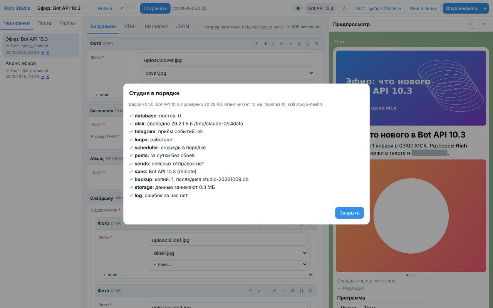

Для Claude Code: когда сессия открывается в папке студии, хук `SessionStart` (`.claude/hooks/studio_health.py`) одной строкой говорит, если студия не в порядке. Skill `studio-health` объясняет каждую проверку, субагент `studio-monitor` только читает и коротко докладывает (попросите «проверь студию» или запустите `/loop 30m` с ним). Через MCP то же дают `studio_health` и `studio_logs`. Как устроены журнал, отчёт о состоянии, уборка и сигнал снаружи: [docs/OBSERVABILITY.md](docs/OBSERVABILITY.md).

`DEADMAN_URL` (healthchecks.io и похожие): студия пингует его раз в 5 минут, `…/fail` при отчёте `fail`; если пинги пропали, внешний сервис напишет вам.

Уборка раз в час забывает ключи повтора завершённых запросов старше суток. Сделанное вами удаляется, только если вы так настроили: `VERSIONS_KEEP` (сколько версий хранить у поста) и `MEDIA_UNUSED_DAYS` (через сколько дней удалять загрузки, которые ничему не нужны). Без них отчёт предупредит, когда ненужные файлы займут больше 200 МБ.

## Безопасность

- **Чужие сайты.** Принимаются только запросы на `localhost`/`127.0.0.1` (другие имена добавляются в `ALLOWED_HOSTS`). Запись с чужого сайта и любой запрос браузера к `/api/…` со страницы другого сайта или другого порта `localhost` отклоняются (403, запись не в JSON — 415): открытая вкладка не отправит пост от вашего бота и не заставит студию собрать бэкап. Под другим именем по простому `http://` браузер не говорит, откуда запрос, поэтому `/api/…` по cookie редактора отвечает только запросам с заголовком `X-Studio-Client` (его шлёт редактор), а адрес `/api/…` в адресной строке даёт 403. Запросы с токеном или ключом в заголовке (curl, клиенты MCP) проходят. Открытую студию (ни ключа, ни токенов) под таким именем это не защищает: cookie ей не нужна, и GET со страницы любого сайта она выполнит (ответ странице не достанется, но zip с бэкапом студия соберёт). Читать и публиковать её и так может любой, кто дотянется до неё по сети, поэтому студии не только на `localhost` выдайте токены или задайте ключ.
- **Доступ.** Пока не задан `STUDIO_API_KEY` и нет ни одного токена, студия открыта, как локальный инструмент. Иначе каждый запрос, кроме страницы редактора, `/healthz` и `/readyz`, должен прийти с `Authorization: Bearer <токен>` или `X-API-Key`. Токены именные, у каждого свой уровень: `read` (только читать), `draft` (черновики, файлы, проверка канала, предпросмотр себе в личку), `publish` (публиковать, откладывать, заменять, удалять посты; предпросмотр в другой чат), `admin` (ещё `/api/raw` и бэкап). `STUDIO_API_KEY` равен `admin`. Выдать: `make token NAME=claude-laptop LEVEL=draft` (токен печатается один раз, хранится только хэш), список: `make tokens`, отозвать: `make token-revoke NAME=claude-laptop` (заодно закрывает его сессии в редакторе). В контейнере: `docker compose exec rich-studio python cli.py token add claude-laptop --level draft`. Отзыв последнего токена студию не открывает.
- В историю постов пишется имя токена, так что видно, какой агент что опубликовал. Инструменты MCP проверяют уровень токена: агенту с `draft` публикующие инструменты ответят ошибкой. Для Claude Code токен кладётся в `STUDIO_TOKEN`.
- Редактор спрашивает ключ или токен один раз и меняет его на cookie сессии (`HttpOnly`, `SameSite=Strict`, `Secure` по HTTPS, `SESSION_DAYS` дней): скрипты страницы ключа не видят. Сессия, открытая по `STUDIO_API_KEY`, кончается, когда ключ меняют или убирают. Выйти: `DELETE /api/session`.
- `/api/raw` доступен только уровню `admin`, `RAW_API=off` выключает его совсем. Без заголовка `X-Confirm: yes` там работают только методы, которые читают, отправляют или редактируют сообщения (`get*`, `send*`, `edit*`, `answer*`, `copy*`, `forward*`, закреп, `stopPoll`, `setMessageReaction`); остальные, включая методы, которые Telegram добавит позже, требуют подтверждения.
- `options` не может переписать `chat_id`, `rich_message`, `reply_markup`, `message_id` и задать `ephemeral_message_parameters`: с последним пост увидел бы один человек, а студия записала бы его постом канала.
- Токен бота, `STUDIO_API_KEY` и токены `rs_…` маскируются в журнале, `/api/health`, ответах об ошибках и ошибках MCP: прокси или неверный `TG_API_BASE` могут вернуть URL с токеном в тексте ошибки.
- Предпросмотр чистит HTML по белому списку тегов и ссылок, страницы работают под строгим CSP и грузят только скрипты студии, без CDN и inline-скриптов. `GET` в студии ничего не меняет.
- В `upload:<имя>` годится только имя файла из загрузок: путь (`/`, `\`, `..`), имя с точки и управляющие символы студия отклоняет (400) везде, в черновике и шаблоне тоже. Отложенный пост с файлом, которого нет в загрузках, отклоняется сразу, а не в назначенное время.

## Разработка

Правила и проверки для изменений: [AGENTS.md](AGENTS.md) (`make check`, `make check-fast`, `make e2e-local` — браузерные проверки на своём стенде, студию на 7424 не трогают). Устройство кода: [docs/ARCHITECTURE.md](docs/ARCHITECTURE.md), решения и отказы: [docs/decisions/](docs/decisions/README.md), наблюдаемость: [docs/OBSERVABILITY.md](docs/OBSERVABILITY.md).
